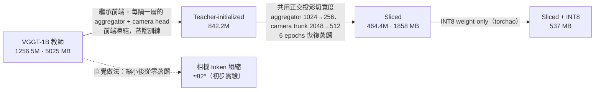

# VGGT-final：壓縮 3D 基礎模型 VGGT（程式碼、權重與實驗紀錄）

本 repo 收錄下列論文的完整程式碼、論文用到的模型權重、所有實驗報告，以及詳細的實驗說明：

> **Compressing a 3D Foundation Model: Teacher-Initialized Distillation and Global Projection Slicing for Deployable VGGT**
> Tzu-Chi Huang, Kuan-You Chen, Chung-Wei Lin, Chow-Sing Lin（國立臺南大學 資訊工程學系）
> ICS 2026（International Computer Symposium），已接受，將收錄於 Springer CCIS。論文 PDF 待正式出版後再補上連結。

**English summary.** VGGT (1.2B parameters) predicts camera pose, depth, point maps and tracks in one forward pass. We compress its camera-pose and depth pathways. A small student distilled from scratch collapses: its camera token becomes view-independent (cross-view cosine 0.998, rotation error about 82°). Inheriting the DINOv2 front end, every other aggregator block and the camera head from the teacher, with the front end frozen, fixes this at 842M parameters. A spectral probe shows the residual stream is low-rank, so we then slice the aggregator and camera-head widths to a quarter with one shared orthogonal projection per stream plus six epochs of recovery distillation (464M parameters, 88.3% of the teacher's ground-truth RRA@15). INT8 weight-only quantization brings the checkpoint to 537 MB (9.4× smaller than the fp32 teacher). The same slicing fails on the DINOv2 front end in every setting we tested.

---

## 一句話看懂

小模型從零蒸餾時，**相機姿態會塌縮成一個平均姿態**（深度卻學得好好的）。解法分兩步：先**從教師模型繼承**姿態路徑上的權重（842M），訓練完再用**一個共用的正交旋轉把殘差流切到 1/4 寬**並短暫恢復訓練（464M），最後做 INT8（537 MB）。



## 重點結果

所有數字都來自論文（camera-ready 版）與 `distill2/reports/` 的原始紀錄；每個數字的出處與量測設定見 [`docs/RESULTS.md`](docs/RESULTS.md)。延遲與記憶體在單張 RTX 5080、4 張 518×518 影像、bf16 下量測。

| | 教師 VGGT-1B | Teacher-initialized | Sliced（論文主模型） | Sliced + INT8 |
|---|---|---|---|---|
| 參數 | 1256.5M | 842.2M | 464.4M | 464M |
| 檔案大小 | 5025 MB | 3369 MB（本 repo 的檔案） | 1858 MB | **537 MB** |
| 延遲（4 幀） | 388.1 ms | 219.1 ms | **201.3 ms** | 229.9 ms（無 INT8 kernel） |
| 峰值記憶體（4 幀） | 9.21 GB | 5.85 GB | 3.89 GB | **1.81 GB** |
| 運算量（4 幀） | 16814.3 GFLOPs | 9919.2 | 7496.8 | 7496.8 |
| 16 GB 內最多幀數 | 24 | 48 | 64 | 80 |
| 模擬 8 GiB 預算（含 CUDA context）可處理幀數 | 1 | 12 | 24 | 32 |
| 對照教師的旋轉誤差 | — | 2.87°（完整訓練） | 5.20° | 5.21° |
| 對照 CO3D ground truth：RRA@15 | 1.000 | 0.964 | 0.883 | 未量測 |
| 對照 CO3D ground truth：AUC@30 | 0.976 | 0.876 | 0.767 | 未量測 |

- Ground truth 指標：CO3D 65 個測試場景、每場景 10 幀；AUC@30 只算旋轉。這個切分比文獻常用的協定容易，請讀成「相對教師保留多少」：842M 保留 RRA@15 的 96.4%、464M 保留 88.3%（AUC@30 分別 89.8%、78.6%）。
- 消融（論文 Table 1）：只繼承單一元件，誤差都停在約 76°；三個元件一起繼承、而且前端凍結，才降到 4.32°。
- 層剪枝（Table 3）：12 → 8 個區塊還能用（9.45°），6 個以下就塌縮。
- 前端（DINOv2）切寬度：在測過的所有設定都失敗（48°–77°）。
- 學生模型保留相機姿態與深度路徑；track head 已移除，point head 沒有訓練也沒有評估。

## Repo 結構

```
VGGT-final/
├── README.md              本檔
├── docs/                  詳細說明（見下方索引）
├── distill2/              論文的全部程式（蒸餾、評估、剪枝、探針、切片、恢復、量化、量測、視覺化）
│   ├── reports/           每個實驗的原始報告（md / csv / json）
│   ├── viz/               視覺化圖（842M 模型的深度、點雲、相機軌跡）
│   ├── README.md          作者在 distill2/ 的重現筆記
│   └── CHANGES.md         開發期間的改動紀錄
├── scripts/               產生 teacher soft label（VGGT 對 CO3D 推論）與舊管線的評估腳本
├── vggt/                  VGGT 模型套件（Meta 原始碼 + 本專案的 VGGTStudent），pip install -e . 安裝
├── weights/               論文用到的三個模型（Git LFS，約 5.8 GB）與 SHA256
├── pyproject.toml
└── LICENSE.txt            VGGT License
```

## 文件索引

| 文件 | 內容 |
|---|---|
| [`docs/RESULTS.md`](docs/RESULTS.md) | 論文 Table 1–7 與 Fig. 2 的每個數字、對應的原始報告檔與量測設定；論文沒收錄的其他結果；最佳結果一覽 |
| [`docs/REPRODUCE.md`](docs/REPRODUCE.md) | 從環境、資料準備到每個實驗的完整指令與預期輸出、疑難排解 |
| [`docs/IMPLEMENTATION.md`](docs/IMPLEMENTATION.md) | 核心方法在程式裡怎麼做：學生架構、權重繼承對照表、loss、探針、切片的七條規則、恢復蒸餾、INT8、記憶體預算模擬 |
| [`docs/CODE_MAP.md`](docs/CODE_MAP.md) | 每支程式的用途、參數、輸入輸出、對應論文哪張表 |
| [`docs/HISTORY.md`](docs/HISTORY.md) | 研究歷程：從塌縮的發現、各種失敗的嘗試，到最後的方法，以及學到的教訓 |
| [`weights/README.md`](weights/README.md) | 三個模型的說明、下載、合併、載入方式 |

## 快速上手

```bash
git clone https://github.com/yoyo6108876/VGGT-final.git      # 需先安裝 git-lfs；只要程式可加 GIT_LFS_SKIP_SMUDGE=1
cd VGGT-final
pip install -e .                                              # 安裝 vggt 套件；另需 PyTorch（論文用 2.10.0+cu128）
cd distill2
```

```python
import torch
from slicegpt_slice import load_sliced

model = load_sliced("../weights/vggt_sliced_464M_agg256_ch512.pt", "cuda")
images = torch.rand(1, 4, 3, 518, 518, device="cuda")        # [batch, frames, 3, H, W]，值域 0~1
with torch.no_grad(), torch.autocast("cuda", dtype=torch.bfloat16):
    out = model(images)                                       # out["pose_enc"], out["depth"], out["depth_conf"]
```

要從頭重現（產生資料、訓練 842M、切片、恢復、量化、量測），請照 [`docs/REPRODUCE.md`](docs/REPRODUCE.md)。

## 論文與原始紀錄不一致的地方

程式和報告公開後，讀者可以自己對照，所以先把已知的差異列出來（細節見 [`docs/RESULTS.md`](docs/RESULTS.md)）：

1. **評估場景數**：論文寫 Table 4 用前 12 個測試場景。紀錄顯示探針、不重訓的數字（與 2.87°）是 12 個場景；恢復後的數字（4.18°、4.95°、5.36°、5.20°、69.4°、77.2°、48.1°）與 INT8 的 5.20°→5.21° 是前 8 個測試場景（`train_sliced.py` 預設 `--eval_scenes 8`）。Table 1、Table 3 也是 8 個場景。同一個 842M checkpoint 在 12 個場景是 2.87°、在 8 個場景是 3.42°。
2. **842M 的訓練長度**：論文寫 20 epochs × 500 steps；論文用的 checkpoint 實際來自 40 epochs 的訓練。
3. **參數量**：部分舊報告寫 466M，是同一個模型的錯誤數字；正確是 464.4M（state dict 元素數，論文寫 464M）。
4. **延遲的跨 session 漂移**：論文寫約 7%；紀錄中同一模型跨 session 最多差約 15%。論文的加速倍數都是同一個 session 內的比值。

## 沒有放在這裡的東西

- 論文 PDF（待 Springer 出版）。
- 訓練資料：teacher soft label 是 VGGT 對 CO3D 推論的結果，內含 CO3D 影格，無法散布；請用 `scripts/export_co3d_labels.py` 自行產生。
- 其他實驗的 checkpoint（消融、剪枝、其他切片設定等，合計一百多 GB）；需要的話可以用文件裡的指令重新訓練。

## 授權與致謝

- `vggt/` 是 Meta [VGGT](https://github.com/facebookresearch/vggt) 的原始碼（另加本專案的 `vggt/models/vggt_student.py` 與 `aggregator.py` 的小修改），依 [VGGT License](LICENSE.txt) 散布；`weights/` 的模型是 VGGT-1B 的衍生模型，同樣依 VGGT License 散布，僅供研究與非商業用途。
- 前端是 VGGT 內的 DINOv2 ViT-L/14；訓練資料來自 CO3D（CC BY-NC 4.0）；寬度切片的計算不變性想法來自 SliceGPT（Ashkboos et al., ICLR 2024）。

## 引用

```bibtex
@inproceedings{huang2026compressing,
  title     = {Compressing a 3D Foundation Model: Teacher-Initialized Distillation and Global Projection Slicing for Deployable VGGT},
  author    = {Huang, Tzu-Chi and Chen, Kuan-You and Lin, Chung-Wei and Lin, Chow-Sing},
  booktitle = {International Computer Symposium (ICS 2026)},
  series    = {Communications in Computer and Information Science},
  publisher = {Springer},
  year      = {2026},
  note      = {to appear}
}
```
