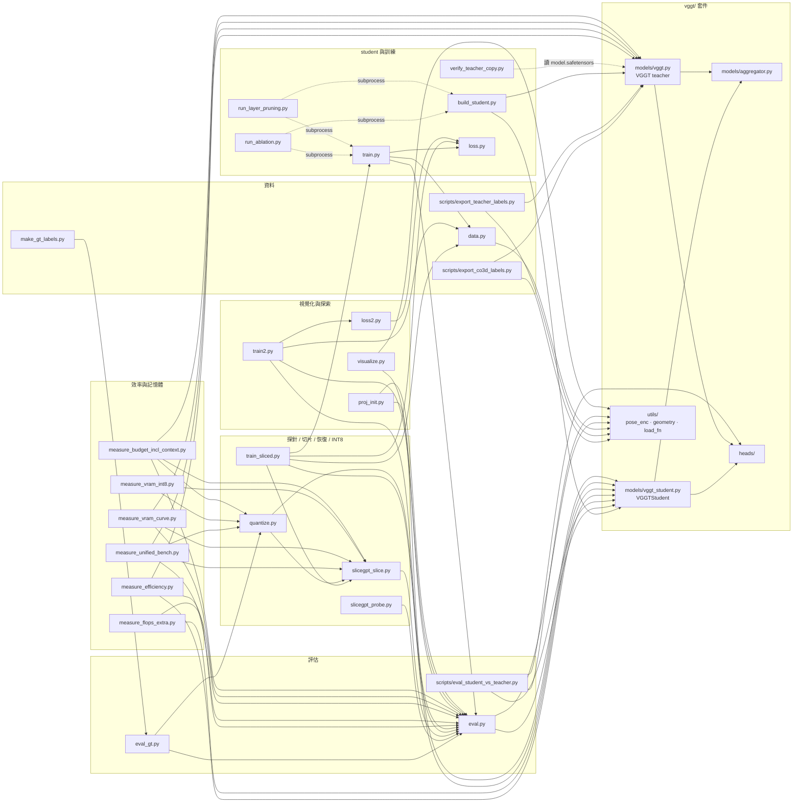
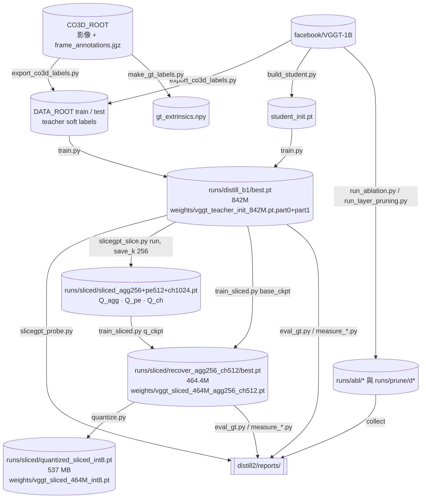

# 程式碼導覽（CODE_MAP）

本文件逐檔說明 repo 裡的程式，每個檔案寫出：做什麼、主要命令列參數與預設值、讀寫哪些檔案、對應論文哪張表／圖或哪份報告、依賴哪些模組。檔案依管線階段排列：資料 → teacher-init student → 訓練 → 評估 → 層剪枝 → 光譜探針 → 切片 → 恢復蒸餾 → INT8 → 效率與記憶體量測 → 視覺化 → 探索性程式（train2 / loss2 / proj_init）。

論文：Tzu-Chi Huang, Kuan-You Chen, Chung-Wei Lin, Chow-Sing Lin，"Compressing a 3D Foundation Model: Teacher-Initialized Distillation and Global Projection Slicing for Deployable VGGT"，ICS 2026（已接受，Springer CCIS，尚未出版）。文中的 §、Table、Fig. 編號都依 camera-ready 版本。

相關文件：數字的彙整見 [RESULTS.md](RESULTS.md)，重現步驟見 [REPRODUCE.md](REPRODUCE.md)，實作細節見 [IMPLEMENTATION.md](IMPLEMENTATION.md)，權重見 [weights/README.md](../weights/README.md)。

---

## 閱讀約定

- 路徑一律相對於 repo 根目錄。
- `<DATA_ROOT>` 指 teacher soft-label 資料集的根目錄。底下有 `train/`、`test/` 兩個 split，每個場景一個資料夾 `<category>__<sequence>/`。
- `<CO3D_ROOT>` 指 CO3D 原始資料的根目錄。每個類別一個資料夾，裡面有各序列的 `images/` 和該類別的 `frame_annotations.jgz`。
- 「（來源：…）」標出數字或敘述的出處。
  - **推算**：用記錄裡的數字做算術得到，記錄本身沒有寫出這個值。
  - **推定**：從程式邏輯或檔名推斷，記錄沒有直接寫明。
  - **作者開發紀錄**：只記在作者私人筆記裡、不在 repo 中的事實；本文只保留核對過的部分。
- `distill2/runs/…`、`distill2/abl/…` 是作者本機的實驗產物。`.gitignore` 排除了 `*.pt`、`runs/`、`abl/`，只有 `weights/*.pt` 例外（來源：.gitignore、.gitattributes）。論文的三個模型以 Git LFS 放在 `weights/`（見 [weights/README.md](../weights/README.md)）：

  | repo 中的檔案 | 訓練時的路徑 | 內容 |
  |---|---|---|
  | `weights/vggt_teacher_init_842M.pt.part0` + `.part1` | `runs/distill_b1/best.pt` | 842M teacher-init student。3,368,981,430 bytes 的原檔因 GitHub LFS 單檔 2 GB 上限切成兩段，用 `cat`（或 Windows 的 `copy /b`）合併成 `weights/vggt_teacher_init_842M.pt`；SHA256 見 weights/SHA256SUMS.txt |
  | `weights/vggt_sliced_464M_agg256_ch512.pt` | `runs/sliced/recover_agg256_ch512/best.pt` | 主模型（464.4M），1,908,372,429 bytes |
  | `weights/vggt_sliced_464M_int8.pt` | `runs/sliced/quantized_sliced_int8.pt` | 主模型的 INT8 weight-only 版，537,215,008 bytes |

  其他 checkpoint（`runs/abl/*`、`runs/prune/*`、`runs/sliced/` 下的其他目錄、`student_init.pt` 等）不在 repo 裡。
- 在 `distill2/` 下執行時，這三個檔的路徑是 `../weights/...`。文中寫 `runs/...` 的地方，是腳本預設值或作者訓練時的路徑。
- 文中引用不在 repo 的 checkpoint 的存檔欄位（`epoch`、`eval`、`k_*`）時，數值是 2026-10-17 直接讀 checkpoint metadata 得到的（作者開發紀錄）；`weights/` 的三個檔可以自己讀出來核對。
- 名詞對照：
  - 「teacher-init student／842M」指論文 §3.3 的 teacher-initialized student，內部記錄叫 Path B。
  - 「主模型／464M」指論文的 Sliced（agg256 + trunk512）模型。
- teacher-relative 指標和 CO3D GT 指標名稱都叫 RRA@15，但定義不同（見 [eval.py](#distill2evalpy)），不能混用。

## 執行前提

- 在 repo 根目錄執行 `pip install -e .`，安裝 `vggt/` 套件（依 `pyproject.toml`，套件名 `vggt`）。
- `distill2/` 的腳本彼此用平面 import（例如 `from data import …`、`from eval import …`），所以必須在 `distill2/` 目錄下執行。
- 需要的套件：
  - `pyproject.toml` 列出的：numpy<2、Pillow、huggingface_hub、einops、safetensors、opencv-python。
  - torch：論文環境是 torch 2.10.0+cu128（來源：論文 §4.7）。
  - matplotlib：visualize.py 用。
  - fvcore：measure_efficiency.py 算 GMACs 用，選用。
  - torchao：INT8 用；論文用 torchao 0.17 的 `Int8WeightOnlyConfig`（來源：論文 §4.7）。
  - `nvidia-smi`：measure_budget_incl_context.py 用。
- 硬體：論文所有實驗都在單張 RTX 5080 16 GB 上跑（來源：論文 §4.1）。
- 權重下載：
  - Teacher 權重 `facebook/VGGT-1B` 從 Hugging Face 下載。一般腳本用 `VGGT.from_pretrained`；verify_teacher_copy.py 用 `hf_hub_download` 取 `model.safetensors`。
  - DINOv2 官方權重只在 `pretrained_patch_embed=True` 時才從 `dl.fbaipublicfiles.com` 下載（來源：vggt/models/aggregator.py 第 25–32、201–202 行）。`Aggregator` 的預設值就是 True（同檔第 81 行），而 `VGGT`（teacher）建構 Aggregator 時沒有傳這個參數（vggt/models/vggt.py 第 22 行），所以每次 `VGGT.from_pretrained` 也會先下載（之後由 torch.hub 快取）DINOv2 ViT-L/14-reg 權重，再被 HF 權重覆蓋；離線環境要先準備好這個快取。
  - 論文的三個 student 模型在 repo 的 `weights/`（Git LFS），`git clone` 時會一起下載；只要程式、不要權重的作法見 weights/README.md。
- `--data_root` 在不同腳本裡意思不同：
  - 指 `<DATA_ROOT>`（底下有 `train/`、`test/`）的腳本：train.py、train_sliced.py、train2.py、run_ablation.py、run_layer_pruning.py、slicegpt_probe.py、slicegpt_slice.py、make_gt_labels.py。
  - 指 `<DATA_ROOT>/test` 的腳本：eval.py、eval_gt.py、quantize.py、visualize.py。
- Windows 路徑問題：
  - 很多預設值是 Windows 反斜線相對路徑，例如 `runs\distill_b1\best.pt`、`reports\slicegpt_probe.md`。
  - measure_unified_bench.py、measure_flops_extra.py、measure_vram_curve.py、measure_vram_int8.py、measure_budget_incl_context.py 把 checkpoint 與輸出路徑直接寫死在程式裡（measure_efficiency.py 用命令列參數）。要用 `weights/` 的模型跑這幾支，得改程式裡的路徑，或把合併後的檔案放到程式預期的位置（例如 `distill2/runs/sliced/recover_agg256_ch512/best.pt`）。
  - 在 Linux／macOS 上反斜線不是路徑分隔字元，需要改成 `/`，或用參數覆寫。
  - run_ablation.py、run_layer_pruning.py、slicegpt_probe.py、slicegpt_slice.py 的 `--data_root` 預設值是作者本機的絕對路徑（本文寫作 `<DATA_ROOT>`），使用時一律要自己指定。
- 舊環境的套件衝突：舊環境曾同時有兩份 `vggt` 套件。`sys.path` 順序錯時會載到舊版，它的 camera head 是 `trunk_depth=2`、只支援 conv patch embed，結果把訓練好的 4 層 camera head 截掉，評估因此失真（來源：[distill2/CHANGES.md](../distill2/CHANGES.md) §3(C)；作者開發紀錄）。本 repo 的 `vggt/` 是含 `VGGTStudent` 的那一版（camera head `trunk_depth=4`、支援 DINOv2 patch embed，見 vggt/models/vggt_student.py 第 141–150 行）。用 `pip install -e .` 安裝、不要另外改 `sys.path` 就不會遇到這個問題。

---

## 0. 總覽

| 階段 | 檔案 | 主要產出 | 論文 |
|---|---|---|---|
| 資料 | scripts/export_co3d_labels.py、scripts/export_teacher_labels.py、distill2/data.py、distill2/make_gt_labels.py | `<DATA_ROOT>/{train,test}/<scene>/`、`gt_extrinsics.npy` | §4.1、§4.3 |
| Teacher-init student | vggt/（含 models/vggt_student.py）、distill2/build_student.py、distill2/verify_teacher_copy.py | `student_init.pt` | §3.1、§3.3、Table 6 |
| 訓練 | distill2/loss.py、distill2/train.py、distill2/run_ablation.py | `runs/distill_b1/best.pt`、reports/ablation_report.* | §3.3、App. B、Table 1 |
| 評估 | distill2/eval.py、distill2/eval_gt.py、scripts/eval_student_vs_teacher.py | teacher-relative 指標、reports/eval_gt_*.md、reports/eval_results_before.json | Tables 1–4 的指標、Table 2、§3.2 |
| 層剪枝 | distill2/run_layer_pruning.py | reports/layer_pruning_report.* | Table 3 |
| 光譜探針 | distill2/slicegpt_probe.py | reports/slicegpt_probe.md | §3.4、Table 4（Energy、Probe） |
| 切片 | distill2/slicegpt_slice.py | `runs/sliced/sliced_*.pt`、reports/slicegpt_slice*.md | §3.5、App. C、Table 4（No retr.） |
| 恢復蒸餾 | distill2/train_sliced.py | `runs/sliced/recover_*/best.pt` | §3.5、§4.5、§4.6、Table 4（recov.） |
| INT8 | distill2/quantize.py | `quantized_*.pt`、reports/quantize*_report.md | §4.7 |
| 效率與記憶體 | distill2/measure_efficiency.py、measure_unified_bench.py、measure_flops_extra.py、measure_vram_curve.py、measure_vram_int8.py、measure_budget_incl_context.py | reports/efficiency_*.md/csv、reports/*.json | Table 3（latency）、Table 5、Table 7、Fig. 2、App. D |
| 視覺化 | distill2/visualize.py | distill2/viz/*.png | 論文未使用 |
| 探索性 | distill2/loss2.py、distill2/train2.py、distill2/proj_init.py | `runs/distill2_s*`、`runs/proj512` | 論文未報告 |

表中的產出裡，`runs/distill_b1/best.pt`、`runs/sliced/recover_agg256_ch512/best.pt`、`runs/sliced/quantized_sliced_int8.pt` 三個在 repo 的 `weights/` 有原檔副本（見[閱讀約定](#閱讀約定)）；其他 `runs/`、`abl/` 產物和資料集都不在 repo 裡。

---

## 1. 資料

### `scripts/export_co3d_labels.py`

**做什麼**

- 批次對 CO3D 的每個場景跑一次 VGGT-1B teacher，把預測存成 `.npy`。每個類別的場景先打散，再切成 train／test。
- 論文用的 soft labels（427 個訓練場景、65 個測試場景、33 個類別）就是用這支產生的（來源：distill2/README.md「三、資料」；論文 §4.1）。
- 每個場景的處理流程：
  1. 從影像中均勻抽樣，最多 `--max_images_per_scene` 張。
  2. 用 `load_and_preprocess_images_square` 補成正方形，再縮放到 `--target_size`。
  3. 全部抽到的影像在**同一次** forward 中一起送進 teacher。
- 已經有 `meta.json` 的場景會跳過；處理失敗的場景會刪掉該場景的輸出，避免殘缺資料被 Dataset 讀到（第 126–129、358–363 行）。

**參數**

| 參數 | 預設 | 說明 |
|---|---|---|
| `--co3d_root` | 必填 | `<CO3D_ROOT>`，結構為 `<category>/<sequence>/images/*.jpg` |
| `--categories` | 必填（可多個） | 要處理的類別 |
| `--out_root` | `teacher_dataset` | 輸出根目錄，即 `<DATA_ROOT>` |
| `--save_points` | 關 | 另存 `world_points.npy`、`world_points_conf.npy` |
| `--target_size` | 518 | 必須是 14 的倍數 |
| `--max_scenes` | 全部 | 每個類別最多處理幾個場景 |
| `--test_ratio` | 0.1 | 每個類別的 test 場景數為 `max(1, round(n × ratio))` |
| `--min_images` | 5 | 影像少於這個數的場景略過 |
| `--max_images_per_scene` | 10 | 每個場景均勻抽樣的張數上限 |
| `--seed` | 42 | 打散與切分用的亂數種子 |

**讀取**：`<CO3D_ROOT>/<category>/<sequence>/images/*`。

**寫出**：`<out_root>/{train,test}/<category>__<sequence>/` 下的這些檔案：

- `images/0000.png …`：預處理後的影像。
- `depth.npy` [S,H,W]、`depth_conf.npy` [S,H,W]。
- `point_mask.npy` [S,H,W]：`depth > 1e-8` 的像素，存成 float32。
- `extrinsics.npy` [S,3,4]、`intrinsics.npy` [S,3,3]、`pose_enc.npy` [S,9]、`original_coords.npy`。
- 選用：`world_points.npy` [S,H,W,3]、`world_points_conf.npy`。
- 以上全部以 float32 儲存（第 82–85 行）。
- `meta.json`：記錄 `scene_name`、`num_images`、`image_paths`、`source_images`（CO3D 原始檔名，eval_gt.py 與 make_gt_labels.py 用它對應 GT 標註）、`teacher_model`、`target_size`、`image_hw`、`save_points`、`files`（第 195–205 行）。

**精度**：GPU compute capability ≥ 8 時用 bf16，否則用 fp16（第 274–279 行）。

**記錄缺口**

- 產生論文資料集時實際用的類別清單、`--max_images_per_scene`、`--save_points` 等參數，記錄裡都沒有寫下。各場景的 `meta.json` 會記下 `save_points` 和 `num_images`，但資料集不在 repo 裡。
- distill2/README.md「三、資料」列出的場景內容包含 `world_points.npy`，表示當時有開 `--save_points`（推定）。
- distill2/eval.py 第 73 行的註解提到「整段 50 幀」（推定：匯出的幀數多於預設的 10 幀）。reports/eval_results_before.json 的 10 個單場景 `rra_15` 都是 0.02 的倍數，也和每場景 50 幀相符（推定；該檔評估的資料夾是否就是論文資料集，記錄沒有寫）。

**依賴**：`vggt.models.vggt.VGGT`、`vggt.utils.load_fn`、`vggt.utils.pose_enc`。第 48 行把 repo 根目錄插到 `sys.path` 最前面；本 repo 根目錄的 `vggt/` 就是同一份套件。

### `scripts/export_teacher_labels.py`

**做什麼**

- 單一場景版本：輸入 `--scene_dir`（一個影像資料夾），輸出到 `<out_root>/<scene_name>/`。
- 和 export_co3d_labels.py 的差別：
  - 不分 train／test，也不抽樣，全部影像一次送進 teacher。
  - 輸出目錄已存在時會先整個刪除再重建。
  - `save_npy` 沒有再做 `astype(float32)`，但 tensor 都先經 `tensor_to_numpy`（`.float()`）轉成 float32，所以 `point_mask` 一樣存成 float32 的 0／1（第 71–73、88–93 行）；只有原本就是 numpy 的陣列（從深度重建的點雲）保留原本的 dtype。
  - 開了 `--save_points` 但 teacher 沒輸出 `world_points` 時，會用 `unproject_depth_map_to_point_map` 從深度重建點雲。
- distill2/CHANGES.md §5 把它列為「用 teacher 產生 soft labels」的工具；論文用的資料集則由 export_co3d_labels.py 產生（來源：distill2/README.md「三、資料」）。

**參數**

| 參數 | 預設 | 說明 |
|---|---|---|
| `--scene_dir` | 必填 | 一個場景的影像資料夾 |
| `--scene_name` | 從資料夾名推斷 | 資料夾叫 `images` 時改取上一層的名字 |
| `--out_root` | `teacher_dataset` | 輸出根目錄 |
| `--save_points` | 關 | 另存點雲 |
| `--target_size` | 518 | 必須是 14 的倍數 |

**寫出**：場景目錄，檔名與 meta 格式同上。

**依賴**：`VGGT`、`vggt.utils.geometry.unproject_depth_map_to_point_map`、`load_fn`、`pose_enc`。

### `distill2/data.py`

**做什麼**

- `TeacherDataset` 讀 `<DATA_ROOT>/<split>/` 的場景。每個 sample 取一個場景的 `img_per_seq` 幀，回傳 `images`、`depth`、`depth_conf`、`pose_enc`、`point_mask`。
- 場景要同時具備 `meta.json`、`depth.npy`、`depth_conf.npy`、`extrinsics.npy`、`intrinsics.npy`、`pose_enc.npy`、`point_mask.npy` 才會被列入。
- 核心是 `_normalize()`（第 42–70 行），步驟如下：
  1. 把外參轉到「第一個取樣幀 = identity」的座標系。
  2. 把 teacher 的 world points 轉到第一個取樣幀的相機座標，取 `point_mask` 內各點範數的平均當 scale。
  3. 平移與深度都除以 scale。
  4. 用 `extri_intri_to_pose_encoding(..., "absT_quaR_FoV")` 重算 9 維 pose 目標。
- 這對應論文 §3.3 的「each scene is canonicalized to a common coordinate frame and the pose targets are recomputed from the normalized extrinsics」。

**取樣方式**

- train：每次隨機選一個場景，隨機取 k 幀再排序。
- test：依序循環場景，等距取 k 幀。

**建構參數**（`TeacherDataset.__init__`）

| 參數 | 預設 | 說明 |
|---|---|---|
| `data_root` | 必填 | `<DATA_ROOT>` |
| `split` | `"train"` | `train` 或 `test` |
| `img_per_seq` | 4 | 每個 sample 的幀數 |
| `length` | 2000 | 每個 epoch 的 sample 數；test split 用 `max(1, length // 5)` |
| `img_size` | 518 | 只存下來，程式中沒有用到 |
| `gt_pose` | False | True 時外參改讀 `gt_extrinsics.npy` |

**注意**

- 場景沒有 `world_points.npy` 時，scale 固定為 1，只做第一幀正規化（第 55、113–114 行）。
- `gt_pose=True` 時：
  - 外參改成 CO3D GT，但 scale 仍用 teacher 的 world points 計算（並以 GT 第一個取樣幀的外參轉換），深度目標仍是 teacher 深度。
  - 場景沒有 `gt_extrinsics.npy` 時，會默默退回 teacher 外參（第 106–110 行）。
  - 旋轉目標和 scale 無關（第 46 行註解）；平移目標的尺度則不保證和 teacher 深度一致。
  - 這只影響 `--gt_pose` 實驗（reports/gtft_report.md）。
- 回傳的 `depth` 已經除以 scale；eval.py 評估深度時卻用 `depth.npy` 的原值（見 [eval.py](#distill2evalpy)）。

**依賴**：`vggt.utils.geometry.closed_form_inverse_se3`、`vggt.utils.pose_enc.extri_intri_to_pose_encoding`、cv2。使用它的腳本：train.py、train_sliced.py、train2.py。

### `distill2/make_gt_labels.py`

**做什麼**

- 為 `<DATA_ROOT>` 的 train 與 test 每個場景產生 `gt_extrinsics.npy`（float32 [S,3,4]，和 `meta.json` 的 `source_images` 一一對應）。
- 內容是 CO3D 官方標註的外參，經 `eval_gt.pt3d_to_opencv` 轉成 OpenCV world-to-camera。預設轉換慣例是 `flip_xy`。
- 每個類別的 `frame_annotations.jgz` 只解析一次並快取。
- docstring 記錄 `flip_xy` 已驗證過：用它評估時 teacher 的 RRA@15 = 1.000。
- 產物給 data.py 的 `gt_pose=True` 使用（train.py／train_sliced.py 加 `--gt_pose 1`）。

**參數**

| 參數 | 預設 | 說明 |
|---|---|---|
| `--data_root` | 必填 | `<DATA_ROOT>` |
| `--co3d_root` | 必填 | `<CO3D_ROOT>` |
| `--convention` | `flip_xy` | 另有 `flip_yz`、`none` |

**寫出**：`<DATA_ROOT>/{train,test}/<scene>/gt_extrinsics.npy`。找不到序列或任何一幀時，該場景略過並印出 `[skip]`。

**記錄**

- 492 個場景全部產生，覆蓋率 100%（來源：distill2/reports/gtft_report.md）。
- 用 GT 微調 4 epochs、lr 1e-5 的結果（RRA@15 / RTA@15 / AUC@30）（來源：distill2/reports/gtft_report.md；完整五欄見 reports/eval_gt_co3d10_pathb_gtft.md、eval_gt_co3d10_ch512_gtft.md）：

  | 模型 | 微調前 | 微調後 |
  |---|---|---|
  | teacher-init 842M | 0.964 / 0.893 / 0.876 | 0.960 / 0.898 / 0.856 |
  | 主模型 | 0.883 / 0.814 / 0.767 | 0.883 / 0.821 / 0.770 |

- 論文 §4.3 的寫法：「changed RRA@15 by at most 0.004 and AUC@30 by at most 0.020」。
- 和論文的差異：
  - gtft_report.md 的結論說差距「來自容量/壓縮」；論文 §4.3 只說差距「unlikely to come from the teacher-label training signal」，沒有歸因於容量。
  - gtft_report.md 把主模型寫成 466M，這是舊的錯誤數字（見 [§13](#13-記錄與論文不一致之處彙整)）。
  - 微調用的確切指令沒有記錄；報告只寫「從各自最佳權重續訓」（推定：切片模型用 train_sliced.py 的 `--resume_sliced`）。報告提到的權重 `runs/gtft/{pathb,sliced}/last.pt` 不在 repo 裡。

**依賴**：`eval_gt.pt3d_to_opencv`。因此會間接 import eval.py、quantize.py 和 `vggt`；雖然這支只做 numpy 運算，仍需要 torch 環境。

---

## 2. Teacher-init student

### `vggt/` 套件（含 student 的 VGGT fork）

#### `vggt/models/vggt_student.py` — `VGGTStudent`

**做什麼**

- 輸入輸出介面與 `VGGT` 相同的 student，組成如下：
  - `Aggregator`：patch embed 加上 `agg_depth` 組 frame／global 交替注意力 block。
  - `CameraHead(dim_in=2×embed_dim, trunk_depth=4, num_heads)`。
  - depth `DPTHead`、point `DPTHead`、選用的 `TrackHead`。
- depth／point head 比 teacher 窄：`features=128`、`out_channels=[128,256,512,512]`（第 152–182 行）。teacher 用的是 `vggt/heads/dpt_head.py` 的預設 `features=256`、`[256,512,1024,1024]`。這就是 depth head 不從 teacher 複製、改成從頭訓練的原因；論文 Table 6 的 depth head 從 32.7M 變成 9.6M。
- DPT 讀取的中間層由 `_compute_intermediate_idx(agg_depth)` 按 teacher `[4,11,17,23]` 的比例換算：
  - 12 層 → `[2,5,8,11]`（docstring）。
  - 8 / 6 / 4 層用同一公式得到 `[1,3,5,7]`、`[1,2,4,5]`、`[1,2,3,3]`（推算）。
- camera／depth／point head 在 `torch.cuda.amp.autocast(enabled=False)` 區塊內執行（第 266–284 行）；track head 在這個區塊外。eval 模式下輸出也會附上 `images`。
- 檔頭註記：docstring 裡的規格表是早期階段寫的；論文的 student 由 distill2/build_student.py 建立（第 1–4 行）。

**建構參數**

| 參數 | 預設 | 說明 |
|---|---|---|
| `img_size` / `patch_size` | 518 / 14 | |
| `embed_dim` | 512 | 用 DINOv2 時必須等於 384（vits14）、768（vitb14）或 1024（vitl14），否則丟 `ValueError` |
| `agg_depth` | 12 | frame／global block 各幾個 |
| `num_heads` | 8 | |
| `patch_embed` | `"conv"` | 或 `dinov2_vits14_reg` / `dinov2_vitb14_reg` / `dinov2_vitl14_reg` |
| `pretrained_patch_embed` | True | DINOv2 時是否下載官方權重；從 checkpoint 載入時應設 False |
| `enable_camera` / `enable_depth` / `enable_point` / `enable_track` | True / True / True / False | |

**論文中用到的設定**

- teacher-init student 與主模型：`embed_dim=1024`、`agg_depth=12`、`num_heads=16`、`dinov2_vitl14_reg`（build_student.py）。
- scratch student：`embed_dim=512`、`conv`、`num_heads=8`（measure_efficiency.py），實測 146.4M（來源：reports/efficiency_report.md）。
- docstring 寫的「~121M」「~96M」是舊估計，和實測的 146.4M、110.7M 不符（來源：reports/efficiency_report.md）。

**輸出 key**

- `pose_enc` [B,S,9]、`pose_enc_list`（camera head 4 次 refinement 的每一次）。
- `depth` [B,S,H,W,1]、`depth_conf`。
- `world_points`、`world_points_conf`。
- 選用的 `track` 系列；eval 模式下的 `images`。
- point head 會被建立、也會前向，但沒有任何 loss 讀它的輸出（見 loss.py），所以是 unsupervised。這和論文 §3.1、App. B 一致。

#### `vggt/models/aggregator.py` — `Aggregator`

- patch embed：
  - `"conv"` 時用 `vggt/layers/patch_embed.py` 的 `PatchEmbed`。
  - DINOv2 時用 `vggt/layers/vision_transformer.py` 的 `vit_small/base/large/giant2`。
- 特殊 token：
  - `camera_token` [1,2,1,C]、`register_token` [1,2,4,C]，第一幀和其餘幀各用一組（`slice_expand_and_flatten`）。
  - `patch_start_idx = 5`。
- 位置編碼：2D RoPE（`rope_freq=100`），特殊 token 不套用。
- `forward` 回傳每個 block 的 `[frame, global]` 串接輸出（寬 2C）組成的 list。
- 訓練模式會對每個 block 使用 gradient checkpointing（第 320–323、343–346 行）。
- `pretrained_patch_embed=True` 且 patch embed 是 DINOv2 時，從 `_DINOV2_PRETRAINED_URLS` 下載官方 reg4 權重，以 `strict=False` 載入（第 201–227 行）。這是本專案對上游 VGGT 的修改（檔頭第 6 行註記）。論文 Table 1 中「official pretrained DINOv2」那幾列，就是 build_student.py 不複製 patch embed 時走這條路。
- 切片程式動到的都在這個類別：`camera_token`、`register_token`、`patch_embed`、`frame_blocks` / `global_blocks`，以及 aggregator 的輸出。

#### `vggt/models/vggt.py` — `VGGT`（teacher）

- 繼承 `PyTorchModelHubMixin`，用 `VGGT.from_pretrained("facebook/VGGT-1B")` 載入。
- aggregator 是預設的 24 層、寬 1024；camera head 預設 `trunk_depth=4`、16 heads；DPT head 用預設寬度；含 track head。
- 使用者：build_student.py、兩支 export 腳本、measure_*。

#### `vggt/heads/`、`vggt/layers/`、`vggt/utils/`

| 檔案 | 用途（與本專案相關的部分） |
|---|---|
| `heads/camera_head.py` | `CameraHead`：取最後一層 aggregator 輸出的 camera token 做 `token_norm`，接著迭代 4 次：`embed_pose`（上一次的預測）→ adaLN 調變（`poseLN_modulation`、`adaln_norm`）→ `trunk`（4 個 `Block`，寬 2048）→ `trunk_norm` → `pose_branch` MLP 預測增量；每次迭代都經 `head_act.activate_pose` 後放進輸出清單 |
| `heads/dpt_head.py` | `DPTHead`（depth／point） |
| `heads/track_head.py`、`heads/track_modules/` | 追蹤 head；所有 student 都不啟用 |
| `layers/block.py` | pre-LN `Block`：`norm1 → attn → ls1`、`norm2 → mlp → ls2`；切片手術的對象 |
| `layers/attention.py` | `Attention`：`qkv`、`q_norm`/`k_norm`、RoPE、`F.scaled_dot_product_attention`；slicegpt_slice.py 的 `SlicedAttention` 照它改寫 |
| `layers/layer_scale.py` | `LayerScale.gamma` |
| `layers/vision_transformer.py` | DINOv2 ViT（`patch_embed.proj`、`cls_token`、`register_tokens`、`pos_embed`、`mask_token`、`blocks`、`norm`） |
| `layers/patch_embed.py`、`mlp.py`、`rope.py`、`swiglu_ffn.py`、`drop_path.py` | 基礎層 |
| `utils/pose_enc.py` | `absT_quaR_FoV` 9 維編碼：`[0:3]` 平移、`[3:7]` 四元數、`[7]` fov_h、`[8]` fov_w；`extri_intri_to_pose_encoding` / `pose_encoding_to_extri_intri` |
| `utils/rotation.py` | `quat_to_mat` / `mat_to_quat`；四元數為 scalar-last（XYZW，實部在 index 3） |
| `utils/geometry.py` | `closed_form_inverse_se3`（data.py 用）、`unproject_depth_map_to_point_map`（export_teacher_labels.py 用） |
| `utils/load_fn.py` | `load_and_preprocess_images_square` |
| `dependency/` | 上游的 track／pycolmap 工具；distill2/ 與 scripts/ 都沒有 import |

### `distill2/build_student.py`

**做什麼**

- 建立 student：`embed_dim=1024`、預設 12 層、16 heads、DINOv2 ViT-L/14-reg patch embed，含 camera／depth／point head，不含 track head。
- 依 `--copy` 從 teacher 選擇性複製三個元件：
  - `patch_embed`：整個 DINOv2。
  - `aggregator`：camera／register token，以及 frame／global block。student 第 i 層取自 teacher 第 `i × stride` 層，`stride = teacher 層數 // student_depth`（第 64、73 行）。
  - `camera_head`：整個複製。
- depth／point head 一律不複製，因為 student 版本較窄。
- 不複製 `patch_embed` 時，改從官方 URL 下載 DINOv2 預訓練權重：`pretrained_patch_embed=(not copy_pe)`（第 55 行）。
- 存檔格式為 `{"model": state_dict, "meta": {...}}`。`meta` 含 `embed_dim`、`agg_depth`、`patch_embed`、`num_heads`、`copy`、`init_from`；`eval.build_model` 依 `meta` 重建架構。

**參數**

| 參數 | 預設 | 說明 |
|---|---|---|
| `--out` | `student_init.pt` | 輸出檔 |
| `--copy` | `all` | `all` / `none` / 逗號分隔的 `patch_embed,aggregator,camera_head` |
| `--teacher` | `facebook/VGGT-1B` | |
| `--student_depth` | 12 | 8 / 6 / 4 層時 stride 為 3 / 4 / 6（推算） |

**複製對應**（`--copy all`，12 層；來源：distill2/README.md §四之二）

| 元件 | 張量數 |
|---|---|
| `patch_embed` | 344 |
| `camera_token` / `register_token` | 1 + 1 |
| `frame_blocks[i] ← [2i]` | 216 |
| `global_blocks[i] ← [2i]` | 216 |
| `camera_head` | 69 |
| `depth_head` / `point_head`（不複製） | 62 + 62 |

**注意**

- 複製用 `load_state_dict(strict=False)`，對不上的 key 只會印出來、不會報錯。要確認結果請用 verify_teacher_copy.py。
- `student_init.pt` 是用加入 `--copy` 參數之前的舊版產生的；README 記錄兩版在 `--copy all` 時複製的元件、層對應與做法都相同。depth／point head 是沒有固定 seed 的隨機初始化，兩版都不保證逐位元重現（來源：[distill2/README.md](../distill2/README.md) §四之二）。`student_init.pt` 不在 repo 裡，要用時自己跑 `python build_student.py --out student_init.pt --copy all` 產生。

**對應論文**

- §3.3：every other block（j = 2i），842M，1.49×。
- Table 1 每一列的初始化（由 run_ablation.py 呼叫）。
- Table 3 的 8／6／4 層（由 run_layer_pruning.py 呼叫）。

**依賴**：`VGGTStudent`、`VGGT`。

### `distill2/verify_teacher_copy.py`

**做什麼**

- 拿 student checkpoint 和 teacher 的 `model.safetensors` 逐張量比對。
- 依 build_student.py `--copy all` 的對應規則（`frame/global_blocks.{i} ← {i×stride}`，其餘同名）判斷每個張量「應該複製」或「不複製」，用 `torch.equal` 做位元比對，再按元件彙總。
- student 用 `torch.load(mmap=True)` 讀，teacher 用 safetensors 逐張量讀，不需要 GPU。

**參數**

| 參數 | 預設 | 說明 |
|---|---|---|
| `--ckpt` | 必填（可多個） | student checkpoint |
| `--teacher` | 從 HF 快取取 `facebook/VGGT-1B/model.safetensors` | |
| `--stride` | 2 | 只適用 12 層 student；剪枝模型要給 `24 // depth` |

**寫出**：只印到終端，不寫檔。

**記錄**（2026-10-17 實跑；來源：distill2/README.md §四之二）

- `student_init.pt`：應複製的 847 個張量全部逐位元相同。
- `runs/distill_b1/best.pt`：`patch_embed` 的 344 個張量仍相同，證實凍結有效；其餘 503 個已被訓練更新。
- 兩者的 depth／point head（124 個張量）都和 teacher 不同，符合「不複製」的預期。
- 用 repo 的權重重做這個檢查：先把 `weights/vggt_teacher_init_842M.pt.part0`、`.part1` 合併，再在 distill2/ 下執行 `python verify_teacher_copy.py --ckpt ../weights/vggt_teacher_init_842M.pt`；它就是上面的 `runs/distill_b1/best.pt`。

**對應論文**：沒有直接對應的表；可佐證 §3.3「the front end stays frozen throughout training」。

**依賴**：torch、safetensors、huggingface_hub；不 import `vggt`。

---

## 3. 訓練

### `distill2/loss.py`

**做什麼**

`DistillLoss` = 相機損失 + 深度損失，目標都是 data.py 正規化後的 teacher soft label。

- `camera_losses`（第 31–59 行）：
  - camera head 的每個 refinement stage s 乘上權重 γ^(n−s−1)，γ = 0.6，越後面的 stage 權重越大。
  - 平移：`pose_enc[...,:3]` 的 L1。
  - FoV：`[...,7:]` 的 L1。
  - 旋轉：單位四元數 `[3:7]` 的 1 − |⟨q_pred, q_tgt⟩|，再加上相鄰幀相對旋轉（scalar-last 的四元數共軛相乘）的同一個量。
- `depth_loss`（第 62–70 行）：在 `point_mask` 的有效像素上，用 teacher confidence 加權的 MSE；有效像素少於 100 時回傳 0。
- `DistillLoss` 對 rotation、translation+FoV、depth 三項各自做 EMA 正規化（momentum 0.99，前 100 步不正規化），權重分別為 4.0 / 2.0 / 1.0。
- 預測的 `depth_conf` 和 point head 的輸出都沒有被任何 loss 項使用。

**建構參數**：`rot_weight=4.0`、`cam_weight=2.0`、`depth_weight=1.0`、`momentum=0.99`、`warmup=100`、`gamma=0.6`。

**logs**：`loss_rot`、`loss_transfov`、`loss_camera`、`loss_depth`、`objective`。

**對應論文**：§3.3、App. B。scalar-last 四元數、EMA（0.99、100 步 warm-up）、旋轉權重 4.0 對平移／FoV 權重 2.0、depth 權重 1.0、γ = 0.6，都和論文一致。

**歷史**

- 舊管線的相對旋轉項曾誤用 scalar-first，梯度因此變成雜訊（來源：distill2/CHANGES.md §3(A)；論文 App. B）。
- 舊管線還有一個 EMA buffer 的 device bug；這裡的處理方式是 `forward` 第一次被呼叫時，把 buffer 移到 batch 所在的 device（第 92–95 行；CHANGES.md §3(A)4）。

**依賴**：只用 torch。使用者：train.py、train_sliced.py；loss2.py 重用 `camera_losses` 和 `depth_loss`。

### `distill2/train.py`

**做什麼**

- 主蒸餾訓練迴圈，不用 Hydra，也不用 DDP。
- 從 build_student.py 的存檔載入（`strict=False`），預設凍結 `aggregator.patch_embed`。
- 優化設定：AdamW；總步數的 5% 做線性 warm-up，之後 cosine 衰減到 1e-7；gradient clipping 1.0；bf16 autocast。
- loss 不是有限值時跳過那一步。
- 每 `--eval_every` 個 epoch，用 `eval.quick_eval` 評估 test split 依名稱排序的前 `--eval_scenes` 個場景：
  - 每次都存 `last.pt`。
  - `mean_rot_err` 創新低時存 `best.pt`，並把評估結果放進 `eval` 欄位。

**參數**

| 參數 | 預設 | 說明 |
|---|---|---|
| `--student_init` | 必填 | build_student.py 的輸出，或任一已訓練的 checkpoint |
| `--data_root` | 必填 | `<DATA_ROOT>` |
| `--out_dir` | `runs/distill_b1` | |
| `--epochs` | 40 | |
| `--steps_per_epoch` | 500 | |
| `--img_per_seq` | 4 | 論文用 2（§4.1） |
| `--batch_scenes` | 1 | |
| `--lr` | 5e-5 | |
| `--weight_decay` | 0.05 | |
| `--warmup_frac` | 0.05 | |
| `--num_workers` | 4 | |
| `--eval_every` | 2 | |
| `--eval_scenes` | 8 | test split 前 N 個場景 |
| `--freeze_patch_embed` | 1 | 凍結 `aggregator.patch_embed`（不論是 DINOv2 或 conv） |
| `--throttle` | 0.0 | 每步額外 sleep 的秒數，用來降低 GPU 佔用 |
| `--gt_pose` | 0 | 1 時 pose 目標改用 `gt_extrinsics.npy` |

**寫出**：`<out_dir>/last.pt`、`<out_dir>/best.pt`，內容為 `{"model", "meta", "epoch"}`，`best.pt` 另含 `"eval"`。

**模型選擇**：`best.pt` 是依 test split 前 8 個場景的 `mean_rot_err` 選出來的，程式沒有獨立的 validation split。論文 Table 1、Table 3 和 Table 4 的恢復後數字，都是同一批場景上、存在 checkpoint 裡的 `eval`（見 run_ablation.py、run_layer_pruning.py、train_sliced.py）。

**對應論文**：§3.3、§4.1（AdamW 5e-5、weight decay 0.05、5% warm-up、cosine、bf16、clip 1.0）。

**記錄與論文不一致**

- Epoch 數：
  - 論文 §4.1 寫 main run 是「20 epochs of 500 steps」、每序列 2 幀。
  - 後續所有腳本預設使用的 842M checkpoint 是 `runs/distill_b1/best.pt`（repo 中為 `weights/vggt_teacher_init_842M.pt`，合併兩段後使用）。它的 `last.pt` 存檔 `epoch=39`（也就是跑了 40 個 epoch），`best.pt` 是 `epoch=37`。
  - train.py 預設 `--epochs 40`。作者開發紀錄裡的訓練指令寫的是 `--epochs 20 --eval_every 2 --img_per_seq 2`；distill2/README.md「四」則依 checkpoint 的 `epoch` 推定 `runs/distill_b1` 用的是 train.py 預設（40 epochs），並把 20 epochs 的那次對到 `runs/distill_b1_full`（見下）。
  - 存檔沒有記錄 `steps_per_epoch` 和 `img_per_seq`。
- 同一個 checkpoint 在不同場景數上的結果：
  - `best.pt` 存的 `eval`（前 8 個 test 場景）：3.42°、RRA@15 1.000、abs_rel 0.177、δ1 0.752。
  - 前 12 個場景：2.87°（來源：reports/slicegpt_probe.md 的「無截斷」列，即論文 Table 4 的 k=1024）。
- `runs/` 裡另有 `distill_b1_full`（`last.pt` 和 `best.pt` 都是 `epoch=19`，即 20 epochs；`best.pt` 存的 eval 為 4.44°），不在 repo 裡。腳本預設路徑和 reports/ 都沒有用它；distill2/README.md「四」「七」「八」提到它，「七」裡 82.7° → 4.9°（65 個場景）那一行就是這個 run。

**依賴**：`data.TeacherDataset`、`loss.DistillLoss`、`eval.build_model`、`eval.quick_eval`。

### `distill2/run_ablation.py`

**做什麼**

- 論文 Table 1 的 orchestrator，分三個階段：
  1. build：對 6 種初始化各呼叫一次 build_student.py，產生 `abl/<name>_init.pt`。
  2. train：用 subprocess 呼叫 train.py，訓練到 `runs/abl/<name>/`。
  3. collect：讀各 `best.pt` 的 `eval` 欄位彙整成表。
- 傳給 train.py 的 `--eval_every` 寫死為 3。

**6 種設定**

| name | `--copy` | 凍結 front end |
|---|---|---|
| `random` | `none`（front end 用官方 DINOv2） | 1 |
| `patch_only` | `patch_embed`（複製 teacher 經 VGGT 訓練過的 front end） | 1 |
| `agg_only` | `aggregator` | 1 |
| `head_only` | `camera_head` | 1 |
| `full` | 三者全部 | 1 |
| `full_ft_pe` | 三者全部 | 0 |

**參數**

| 參數 | 預設 | 說明 |
|---|---|---|
| `--stage` | `all` | `build` / `train` / `collect` / `all` |
| `--data_root` | `<DATA_ROOT>` | 原始碼寫死作者本機路徑 |
| `--epochs` | 15 | |
| `--steps_per_epoch` | 400 | |
| `--img_per_seq` | 2 | |
| `--eval_scenes` | 8 | |
| `--throttle` | 0.0 | |
| `--only` | `""` | 逗號分隔，只跑部分設定 |
| `--out_prefix` | `ablation_report` | 相對於 distill2/ |

**寫出**：`abl/*_init.pt`、`runs/abl/<name>/{best,last}.pt`、`distill2/<out_prefix>.md/.csv`。預設寫在 distill2/ 下而不是 reports/；repo 中的副本是 distill2/reports/ablation_report.*。

**結果**（論文 Table 1；來源：reports/ablation_report.md）

| 設定 | rot_err | RRA@15 | abs_rel | δ1 |
|---|---|---|---|---|
| random | 76.18° | 0.188 | 0.235 | 0.642 |
| patch_only（論文 FE only） | 75.59° | 0.198 | 0.260 | 0.616 |
| agg_only | 75.58° | 0.208 | 0.265 | 0.574 |
| head_only | 75.48° | 0.208 | 0.247 | 0.578 |
| full | 4.32° | 1.000 | 0.189 | 0.746 |
| full_ft_pe（論文 full, FE tuned） | 75.68° | 0.219 | 0.248 | 0.632 |

**評估子集**

- 數字來自訓練中 `quick_eval` 在 test split 前 8 個場景（4 個類別）、每場景 12 幀的結果（`--eval_scenes 8`）。
- 論文沒有寫出 Table 1、Table 3 的場景數；§4.1 只說明 Table 4 的 12 場景子集。

**Epoch 數**

- 腳本預設 15；distill2/README.md「五」的指令用 `--epochs 12`。
- `runs/abl/full`、`runs/abl/random` 的 `last.pt` 都是 `epoch=11`，即 12 個 epoch。
- 論文 §4.1 寫「12–15 epochs of 400 steps」。

**依賴**：用 subprocess 呼叫 build_student.py、train.py；collect 階段用 `torch.load`。

---

## 4. 評估

### `distill2/eval.py`

**做什麼**

teacher-relative 評估，也提供幾乎所有腳本共用的工具函式：

- `build_model(meta, device)`：依 `meta` 建 `VGGTStudent`，`pretrained_patch_embed=False`，不會下載權重。
- `load_student(ckpt)`：載入一般（未切片）的 checkpoint（`strict=False`），`track_head.*` 的 missing／unexpected 不列入警告。repo 中的 842M 模型可用 `load_student("../weights/vggt_teacher_init_842M.pt", "cuda")` 載入（先合併兩段，見 weights/README.md）。
- `_load_scene_images`：讀 `images/*.png`，組成 [1,S,3,H,W]、值域 0–1。
- `eval_scene`：
  - 等距取最多 12 幀，第 0 幀一定在內（第 70–74 行）。
  - 把 student 和 teacher（`pose_enc.npy`）的 pose 都解碼成外參，算每一幀的旋轉誤差。
  - 計算深度的 abs_rel 和 δ<1.25。
- `quick_eval`：取 test 目錄依名稱排序的前 `num_scenes` 個場景，各指標取 `nanmean`。

**命令列參數**

| 參數 | 預設 | 說明 |
|---|---|---|
| `--ckpt` | 必填 | 一般 checkpoint |
| `--data_root` | 必填 | `<DATA_ROOT>/test` |
| `--num_scenes` | 10 | |

只印到終端，不寫檔。

**指標定義**

- `mean_rot_err`：每一幀相對 teacher 的絕對旋轉誤差（度；兩邊的 pose 都以第 0 幀為參考座標），先在場景內平均、再對場景取平均；不是幀對之間的相對旋轉，第 0 幀也算在平均裡。
- `rra_15`：上述每幀誤差小於 15° 的比例。論文 Table 1、3、4 的「RRA@15 against teacher soft labels」就是這個量。它和 eval_gt.py 的 RRA@15（所有幀對的相對旋轉誤差小於 15° 的比例）不是同一個量。例如主模型存檔裡的 0.969 是這個量（vs teacher，前 8 個 test 場景，Table 4），而 eval_gt.py 的 GT 幀對 RRA@15 是 0.883（AUC@30 0.767，Table 2）。
- `abs_rel`、`delta_1`：在 `point_mask` 內、且兩邊深度都大於 1e-6 的像素上，拿 student 深度和 teacher `depth.npy` 的原值比較。沒有做尺度對齊；而訓練目標是除過 scale 的深度（見 data.py）。

**記錄**：distill2/CHANGES.md §4 記錄 distill2 在全部 65 個 test 場景的結果為 4.89°、RRA@15 0.968、abs_rel 0.176、δ1 0.698，沒有註明是哪個 checkpoint；distill2/README.md「四」「七」把同一組數字（4.9°、0.97）歸給 20 epochs 的 `runs/distill_b1_full`，不是論文後續使用的 `runs/distill_b1`。

**限制**：不能載入切片後的 checkpoint；切片模型要用 `quantize.load_any` 或 `slicegpt_slice.load_sliced`。

**依賴**：`VGGTStudent`、`vggt.utils.pose_enc.pose_encoding_to_extri_intri`、cv2。使用者：train.py、train_sliced.py、train2.py、slicegpt_*、quantize.py、eval_gt.py、visualize.py、measure_*、proj_init.py。

### `distill2/eval_gt.py`

**做什麼**

- 相對位姿評估，結果不受全域座標系影響。
- 每個場景取 `--frames` 幀：預設等距；`--random_frames ≥ 0` 時以該值當 seed 隨機取。
- student 前向後得到外參。參考值有兩種：
  - teacher：讀 `pose_enc.npy`。
  - CO3D GT：從 `frame_annotations.jgz` 找同一序列、同一檔名的幀，取 `viewpoint` 的 R、T，經 `pt3d_to_opencv` 轉換。
- 計算方式：
  - 對所有 i<j 的幀對，算相對旋轉 `R_j R_iᵀ` 的誤差。
  - 再算相對平移方向的夾角：用兩個相機中心的差，在第 i 幀座標系中的方向。
  - 彙總成 RRA@15/30、RTA@15/30 和 AUC@30。AUC@30 是 1°–30° 每 1° 的 RRA 平均，只看旋轉（第 65–70 行）。
- `--ref co3d` 時，teacher 也用同一組幀對 GT 評估。
- checkpoint 透過 `quantize.load_any` 載入，一般模型和切片模型都可以。

**參數**

| 參數 | 預設 | 說明 |
|---|---|---|
| `--ckpt` | 必填 | |
| `--data_root` | 必填 | `<DATA_ROOT>/test` |
| `--num_scenes` | 20 | |
| `--frames` | 8 | |
| `--ref` | `teacher` | `teacher` / `co3d` |
| `--co3d_root` | None | `<CO3D_ROOT>`；`--ref co3d` 時必填 |
| `--co3d_convention` | `flip_xy` | `flip_xy` / `flip_yz` / `none` |
| `--random_frames` | -1 | ≥0 時隨機取幀，數值即 seed |
| `--out_prefix` | `eval_gt_report` | |

**寫出**：`<out_prefix>.md`，表頭為「# 相對位姿評估（P0-1）」，內容是一張 method × 指標的表。

**對應論文 Table 2**（65 場景 × 10 等距幀）

| 報告 | 模型 | RRA@15 | RRA@30 | RTA@15 | RTA@30 | AUC@30 |
|---|---|---|---|---|---|---|
| eval_gt_co3d10_pathb.md | teacher | 1.000 | 1.000 | 0.930 | 0.957 | 0.976 |
| eval_gt_co3d10_pathb.md | teacher-init 842M | 0.964 | 0.981 | 0.893 | 0.941 | 0.876 |
| eval_gt_co3d10_k384.md | agg384 654M | 0.905 | 0.939 | 0.826 | 0.910 | 0.792 |
| eval_gt_co3d10_ch512.md | agg256+trunk512 464M | 0.883 | 0.940 | 0.814 | 0.908 | 0.767 |

（來源：distill2/reports/eval_gt_co3d10_{pathb,k384,ch512}.md）

- 指令：`python eval_gt.py --ckpt <ckpt> --data_root <DATA_ROOT>/test --num_scenes 65 --frames 10 --ref co3d --co3d_root <CO3D_ROOT>`。報告表頭是「場景 65｜每場景 10 幀」；distill2/README.md「五之三」記下 464M 列用的是 `--ckpt runs\sliced\recover_agg256_ch512\best.pt --ref co3d --num_scenes 65 --frames 10`（`--data_root`、`--co3d_root` 沒有寫出來）。
- 報告本身沒有記下 `--ckpt`。distill2/README.md「四」記錄 842M 列用的是 40 epochs 的 `runs/distill_b1`；論文沒有說明 842M 列用哪個 checkpoint。用 repo 的權重重跑時，`--ckpt` 給 `../weights/vggt_teacher_init_842M.pt`（合併後）或 `../weights/vggt_sliced_464M_agg256_ch512.pt`；654M 的 agg384 模型不在 repo 裡。
- 這些都是 fp32 模型，沒有 INT8 列（來源：論文 §4.7）。

**其他報告**

- 隨機取幀檢查：eval_gt_co3d10rand_{pathb,k384,ch512}.md 的 RRA@15 / AUC@30 分別是 0.965/0.882、0.923/0.813、0.875/0.762（teacher 1.000/0.979）。用的是 `--random_frames 0`（作者開發紀錄）。和等距版相比，RRA@15 最多差 0.018（k384）、AUC@30 最多差 0.021（k384）（推算），即論文 §4.1 的「changes RRA@15 by at most 0.018 and AUC@30 by at most 0.021」。
- 早期版本：
  - eval_gt_report.md：vs teacher，20 場景 × 8 幀，student 0.984 / 0.988 / 0.977 / 0.986 / 0.888。
  - eval_gt_co3d_{pathb,k384,ch512}.md：vs GT，20 場景 × 8 幀。
  - 論文 Table 2 用的是 65 × 10 的版本（論文 §4.1、Table 2）。
- eval_gt_co3d10_{pathb,ch512}_gtft.md：GT 微調之後的結果；論文 §4.3 只寫了它們和微調前的最大差異（RRA@15 最多 0.004、AUC@30 最多 0.020，見 [make_gt_labels.py](#distill2make_gt_labelspy)）。eval_gt_co3d10_d8combo.md：d8 剪枝 × 切片的組合，論文沒有用。

**注意**

- teacher 列讀的是 `pose_enc.npy`，也就是匯出時 teacher 一次看過該場景**全部匯出影像**所做的預測（export_co3d_labels.py 第 131–145 行）；student 則只看選出來的幀。論文 Table 2 caption 寫「under an identical protocol」；就程式而言，相同的是選哪些幀和怎麼計算指標。
- `teacher_extri` 解碼時影像大小固定用 (518, 518)。
- `--ref co3d` 時，如果 teacher 的 RRA@15 < 0.3，程式會印出「座標慣例可能錯了」的警告。

**依賴**：`eval.load_student`、`eval._load_scene_images`、`quantize.load_any`（間接用到 slicegpt_slice）、`pose_enc`。make_gt_labels.py 重用這裡的 `pt3d_to_opencv`。

### `scripts/eval_student_vs_teacher.py`

**做什麼**

- 舊管線的評估腳本，在 distill2/ 建立之前使用。
- 從 state_dict 推斷架構：
  - `embed_dim`：取自 `aggregator.frame_blocks.0.attn.qkv.weight` 的輸入維度。
  - patch embed 種類：`aggregator.patch_embed.*` 的 key 超過 10 個、且 `embed_dim` 是 384／768／1024 時判定為 DINOv2。
  - camera head trunk 層數：照 checkpoint 重建 `CameraHead`，避免後幾層被截掉。
- 每個場景把**全部幀**一次送進 student，不抽樣。
- 計算的指標：
  - 深度：abs_rel、RMSE、δ1、δ2。
  - 相機：每幀旋轉誤差、RRA@15、平移 L1、焦距相對誤差。
  - 其他：confidence MSE、推論時間。
- 壓縮比用寫死的 1B 近似值計算（第 393 行）。`VGGT` 有 import 但沒有使用。

**參數**

| 參數 | 預設 | 說明 |
|---|---|---|
| `--ckpt_path` | 必填 | |
| `--data_dir` | `teacher_dataset` | 場景直接放在這個目錄下 |
| `--num_scenes` | -1 | -1 表示全部 |
| `--device` | 有 GPU 時為 `cuda` | |
| `--out_json` | `eval_results.json` | |

**寫出**：`<out_json>`，內容為 `{"efficiency", "average", "per_scene"}`。

**對應論文 §3.2 的 preliminary diagnostic**

- distill2/reports/eval_results_before.json 的欄位結構和這支腳本的輸出相同，內容是：
  - 146,432,920 參數（146.4M）的 student、10 個場景。
  - `mean_rot_err` 82.35°、`rra_15` 0.098、`abs_rel` 0.238、`delta_1` 0.620。
  - `compression_ratio` 6.83，是除以 1B 近似值的結果。
- 論文 §3.2：「146.4M-parameter student … abs-rel 0.238 … 82.3° with RRA@15 = 0.098 … scored over 10 scenes with an earlier script」。論文的 8.6× 是對 1256.5M 計算的（1256.5 / 146.4 ≈ 8.58，推算）。
- 作者開發紀錄也把 eval_results.json 描述為塌縮時期的「改善前」對照。

**記錄中的落差**

- distill2/CHANGES.md §4 和作者開發紀錄的起點數字是 82.7°、RRA@15 0.135、abs_rel 1.04，和上面不同；記錄沒有說明這些數字由哪個腳本、哪組場景產生。
- 這個 146.4M 模型是舊的 Hydra 訓練管線（`training/`）訓出來的；檔頭的 checkpoint 路徑範例是 `training/logs/distill_v1/ckpts/checkpoint.pth`。舊管線和這個 checkpoint 都不在 repo 裡（來源：distill2/CHANGES.md §2、§3(B)、§5）。
- 論文 §3.2 的塌縮症狀（跨幀 cosine 0.998、跨幀標準差約 0.01 對 teacher 約 0.5）記錄在 distill2/CHANGES.md §2；上述程式中沒有產生這些數字的腳本。

**依賴**：`VGGTStudent`、`vggt.heads.camera_head.CameraHead`、`load_fn`、`pose_enc`。

---

## 5. 層剪枝

### `distill2/run_layer_pruning.py`

**做什麼**

- 論文 Table 3 的 orchestrator。寬度固定 1024，只改 aggregator 層數。
- 對每個 depth：
  1. 呼叫 `build_student.py --copy all --student_depth d`，`stride = 24 // d`。
  2. 用和消融實驗相同的配方訓練：train.py、凍結 patch embed、`--eval_every 3`。
- collect 階段：
  - 用 `runs/abl/full/best.pt` 當 12 層的基準列。
  - 參數量以 state_dict 的元素總數計算。
  - 壓縮比 = 1256.0 / params。
- 子行程會設 `PYTHONUTF8=1`，避免 Windows 的 cp950 編碼錯誤讓訓練中途停掉（第 34–37 行）。

**參數**

| 參數 | 預設 | 說明 |
|---|---|---|
| `--stage` | `all` | `build` / `train` / `collect` / `all` |
| `--depths` | `8,6,4` | 對應 stride 3 / 4 / 6（推算） |
| `--data_root` | `<DATA_ROOT>` | 原始碼寫死作者本機路徑 |
| `--epochs` | 12 | |
| `--steps_per_epoch` | 400 | |
| `--img_per_seq` | 2 | |
| `--eval_scenes` | 8 | |
| `--throttle` | 0.0 | |
| `--out_prefix` | `reports/layer_pruning_report` | |

**寫出**：`abl/prune_d{d}_init.pt`、`runs/prune/d{d}/{best,last}.pt`、`distill2/reports/layer_pruning_report.{md,csv}`。

**結果**（論文 Table 3；來源：reports/layer_pruning_report.md）

| blocks | params | 壓縮 | rot_err | RRA@15 | abs_rel | δ1 |
|---|---|---|---|---|---|---|
| 12（基準 = `runs/abl/full`） | 842M | 1.49× | 4.32° | 1.000 | 0.189 | 0.746 |
| 8 | 741M | 1.69× | 9.45° | 0.781 | 0.201 | 0.744 |
| 6 | 691M | 1.82× | 56.78° | 0.208 | 0.214 | 0.712 |
| 4 | 641M | 1.96× | 75.74° | 0.198 | 0.227 | 0.658 |

- Table 3 的延遲欄（219.1 / 180.1 / 161.4 / 144.0 ms）不是這支腳本產生的，來自 measure_unified_bench.py（reports/unified_bench.json）。
- 評估子集和 run_ablation.py 相同：前 8 個 test 場景、每場景 12 幀。`runs/prune/d8`、`runs/prune/d6` 的 `last.pt` 都是 `epoch=11`，即 12 個 epoch。
- 延長訓練：作者開發紀錄記下 d8 延長到 24 epochs 得到 9.94°，平台期約 9.5–10°；對應的是 `runs/prune/d8_long`（`last.pt`、`best.pt` 都是 `epoch=23`，`best.pt` 存的 eval 為 9.94°、RRA@15 0.813）。
- `runs/prune/*` 的權重都不在 repo 裡。

**依賴**：用 subprocess 呼叫 build_student.py、train.py；基準列需要 run_ablation.py 產生的 `runs/abl/full/best.pt`。

---

## 6. 光譜探針

### `distill2/slicegpt_probe.py`

**做什麼**

- 論文 §3.4 的探針，完全不改權重。
- 校準：取 train split 依名稱排序的前 `--calib_scenes` 個場景，每個場景取 `--calib_frames` 個等距幀前向。論文 §3.5 說這幾個場景都屬於 apple 類別。
- 用 forward hook 對 24 個位置（`frame[i]`、`global[i]`，i = 0…11）分別累積 block 輸出的均值與共變異數，各自做特徵分解。這是 per-block、centered 的基底。
- 評估：對每個 block 的輸出套用 y ↦ μ + (y − μ) Q_k Q_kᵀ（第 104–117 行），再用 `quick_eval` 評估 test split 前 `--eval_scenes` 個場景。
- 同時報告每個 k 的平均 PCA 能量：前 k 個特徵值的佔比，24 個位置取平均。

**參數**

| 參數 | 預設 | 說明 |
|---|---|---|
| `--ckpt` | `runs\distill_b1\best.pt` | 用 repo 的權重時給 `../weights/vggt_teacher_init_842M.pt`（合併後） |
| `--data_root` | `<DATA_ROOT>` | 原始碼寫死作者本機路徑 |
| `--calib_scenes` | 8 | |
| `--calib_frames` | 6 | |
| `--eval_scenes` | 12 | |
| `--ks` | `1024,896,768,640,512,384,256` | |
| `--out` | `reports\slicegpt_probe.md` | |

**寫出**：`reports/slicegpt_probe.md`。

**結果**（論文 Table 4 的 Energy 與 Probe 欄；前 12 個 test 場景；來源：reports/slicegpt_probe.md）

| k | 平均 PCA 能量 | rot_err | RRA@15 | abs_rel | δ1 |
|---|---|---|---|---|---|
| 1024 | 100.00% | 2.87° | 1.000 | 0.1622 | 0.756 |
| 896 | 99.93% | 2.99° | 1.000 | 0.1614 | 0.760 |
| 768 | 99.82% | 3.06° | 1.000 | 0.1609 | 0.759 |
| 640 | 99.65% | 3.22° | 0.993 | 0.1599 | 0.766 |
| 512 | 99.38% | 3.45° | 0.993 | 0.1595 | 0.773 |
| 384 | 98.91% | 3.86° | 0.986 | 0.1624 | 0.763 |
| 256 | 97.98% | 4.91° | 0.958 | 0.1664 | 0.762 |

論文 Table 4 只列出 k = 1024 / 512 / 384 / 256 四列。

**注意**：這裡的能量是 per-block centered 基底的能量，不是切片用的共享未中心化基底的能量（來源：論文 Table 4 caption、§3.5）。reports/slicegpt_slice.md 另有「共享基底能量」欄，論文沒有使用。

**依賴**：`eval.load_student`、`eval.quick_eval`、`eval._load_scene_images`。

---

## 7. 切片

### `distill2/slicegpt_slice.py`

**做什麼**

論文 §3.5 與 App. C 的權重手術。

**校準**（`calibrate_streams`，第 68–101 行）

一次前向就收集三條殘差流的**未中心化**二階矩，每條流各自做特徵分解，得到一個所有 block 共享的正交基底 Q：

| 流 | 寬度 | 累積的位置 |
|---|---|---|
| aggregator | 1024 | `frame_blocks[0]` 的輸入，加上 24 個 block 的輸出 |
| DINOv2 front end | 1024 | `blocks[0]` 的輸入，加上 24 個 ViT block 的輸出 |
| camera head trunk | 2048 | `trunk` 的輸入，加上每個 trunk block 的輸出；camera head 每次 forward 迭代 4 次，每次都累積 |

**手術函式**（所有摺疊都在 CPU 上用 float64 計算）

- `_surgery_block`（第 194–209 行）：通用的 pre-LN block 手術。
  - LayerNorm 換成 `SlicedNorm`，只除以 σ。
  - 中心化、γ 和旋轉摺進後面的 `qkv` 與 `fc1`（`_fold_in`），β 摺進 bias。
  - LayerScale 和輸出旋轉摺進 `attn.proj` 與 `mlp.fc2`（`_fold_out`）。
  - attention 換成 `SlicedAttention`：輸入寬度變成 k，head 數與 `head_dim` 不變。
- `slice_patch_embed_`（第 212–247 行）：
  - 旋轉 cls／register／mask token、`pos_embed` 和 conv stem 的輸出通道。
  - 24 個 block 做手術。
  - 最後的 norm 摺成出口 adapter（k → 1024），整體包成 `AdaptedPatchEmbed`。
  - 函式開頭 `assert` 確保它在 aggregator 切片**之前**呼叫（第 216 行）。
- `slice_camera_trunk_`（第 250–264 行）：
  - 在 trunk 前插入入口 adapter（2048 → k），4 個 block 做手術。
  - `trunk_norm` 摺進 `pose_branch.fc1`。
  - adaLN 調變（`poseLN_modulation`、`adaln_norm`）和 `token_norm` 留在原本的 2048 基底。
- `slice_model_`（第 267–296 行）：
  - 旋轉 camera／register token。
  - 在 patch embed 出口接 adapter（1024 → k），就是論文 Table 6 註 a 的 1024×256 adapter（0.26M）。
  - 24 個 block 做手術。
  - 在 aggregator 輸出掛 forward hook：用 buffer `deslice_Q`（k × 1024）把每個 2k 寬 tap 的 frame、global 兩半各自轉回 1024，再串成 2048。heads 完全不動。
- `apply_slices_`：依 PE → trunk → aggregator 的順序套用上述手術。
- `load_sliced(path)`（第 369–380 行）：
  1. `build_model(meta)`。
  2. `apply_slices_`：依存檔裡的 Q 和 k 重建切片後的結構。
  3. `load_state_dict`。
  - 切片後的 checkpoint 只能用這個函式載入。
  - 也支援只有 `Q`、`k`（只切 aggregator）的舊格式。

**模式**

- `--check`（第 326–348 行）：
  - 在 CPU、fp32 上，取 test 第一個場景的第 0、5 幀。
  - 三條流都用隨機正交 Q、k 設為滿維，印出 `pose_enc` 和 `depth` 的最大絕對差。
  - 記錄值：pose 3.0e-7、depth 2.6e-6（來源：reports/slicegpt_slice_combo.md 第 5 行；論文 §3.5、App. C）。
- `--run`（第 383–457 行）：
  1. 校準一次，評估 baseline。
  2. 對 `--ks` 的每個 k：重新載入原模型，依 `--k_pe` / `--k_ch` / k 切片，跑 `quick_eval`，計算 storage（state_dict 元素數）；加 `--bench` 時另量延遲。
  3. k 等於 `--save_k` 時存檔。

**參數**

| 參數 | 預設 | 說明 |
|---|---|---|
| `--ckpt` | `runs\distill_b1\best.pt` | 用 repo 的權重時給 `../weights/vggt_teacher_init_842M.pt`（合併後）；`--check` 也用這個檔 |
| `--data_root` | `<DATA_ROOT>` | 原始碼寫死作者本機路徑 |
| `--check` / `--run` | 關 / 關 | |
| `--ks` | `512,384,256` | aggregator 的 k；0 表示不切 |
| `--k_pe` | 0 | DINOv2 front end 的 k |
| `--k_ch` | 0 | camera trunk 的 k（流寬 2048） |
| `--calib_scenes` / `--calib_frames` | 8 / 6 | |
| `--eval_scenes` | 12 | |
| `--bench` | 關 | S=4，10 次平均，3 次 warmup |
| `--save_k` | -1 | |
| `--save_dir` | `runs\sliced` | |
| `--out` | `reports\slicegpt_slice.md` | |

**寫出**

- `--out` 指定的 markdown。
- `<save_dir>/sliced_<label>.pt`，例如 `sliced_agg256+pe512+ch1024.pt`，內容為 `{"model", "meta", "Q_agg", "k_agg", "Q_pe", "k_pe", "Q_ch", "k_ch", "note"}`。

**結果**

- 只切 aggregator、不重訓，前 12 個 test 場景（論文 Table 4 上半部的「No retr.」與 Params 欄；來源：reports/slicegpt_slice.md）：

  | k | rot_err | RRA@15 | storage | latency |
  |---|---|---|---|---|
  | 原模型 | 2.87° | 1.000 | 842M | 223 ms |
  | 512 | 5.62° | 0.958 | 692M | 208 ms |
  | 384 | 34.60° | 0.382 | 654M | 203 ms |
  | 256 | 49.74° | 0.264 | 616M | 199 ms |

- 三流合切、不重訓：`agg0+pe512+ch1024` 72.82°（591M）、`agg256+pe512+ch1024` 74.75°（365M）（來源：reports/slicegpt_slice_combo.md）。論文 Table 4 沒有列這兩個數字。

**主模型基底的來源**

- 當時執行的指令（distill2/README.md §五之三）：
  ```
  python slicegpt_slice.py --run --ks 0,256 --k_pe 512 --k_ch 1024 --bench --save_k 256 --out reports\slicegpt_slice_combo.md
  ```
  README 提醒：reports/slicegpt_slice_combo.md 之後有手動整理過，重跑時請把 `--out` 改成別的檔名（例如 `reports\slicegpt_slice_combo_rerun.md`），以免蓋掉。
- 產生 `runs/sliced/sliced_agg256+pe512+ch1024.pt`（不在 repo 裡）。下一步（train_sliced.py）只取其中完整的 `Q_agg`、`Q_pe`、`Q_ch`，k 則重新指定。主模型的存檔本身也帶著這三個完整的 Q（`weights/vggt_sliced_464M_agg256_ch512.pt`），所以載入或重切都不必重新校準（distill2/README.md §五之三）。
- README 記錄 slicegpt_slice.py 在主模型產生（2026-07-13）之後就沒有再改過。
- `runs/sliced/sliced_k512.pt` 是舊格式（只有 `Q`、`k`，沒有 `meta`），也不在 repo 裡。

**載入主模型**（與 distill2/README.md §五之三、weights/README.md 相同）

```python
import torch
from slicegpt_slice import load_sliced          # 在 distill2/ 下執行

model = load_sliced("../weights/vggt_sliced_464M_agg256_ch512.pt", "cuda")
images = torch.rand(1, 4, 3, 518, 518, device="cuda")   # [B, S, 3, H, W]，值域 0–1
with torch.no_grad(), torch.autocast("cuda", dtype=torch.bfloat16):
    out = model(images)        # out["pose_enc"]、out["depth"]、out["depth_conf"] …
```

直接建 `VGGTStudent` 再 `load_state_dict` 會對不上，因為切片後的結構要先依存檔裡的 Q 和 k 重建。

**和論文描述的差異**：論文 App. C Rule 7 說 trunk 的基底「obtained from second-moment statistics collected at the trunk input」。程式實際累積的是 trunk 輸入**加上**每個 trunk block 的輸出，而且 4 次迭代都算進去（第 81、87–88 行）。

**依賴**：`eval.load_student`、`eval.quick_eval`、`eval._load_scene_images`、`eval.build_model`。使用者：train_sliced.py、`quantize.load_any`（因此也包括 eval_gt.py）、measure_budget_incl_context.py、measure_unified_bench.py、measure_vram_curve.py、measure_vram_int8.py。

---

## 8. 恢復蒸餾

### `distill2/train_sliced.py`

**做什麼**

- 切片模型的恢復蒸餾，有兩種起點：
  - 一般：從 `--q_ckpt` 只取完整的 Q（`Q` 或 `Q_agg`、`Q_pe`、`Q_ch`）和 `meta`；把 `--base_ckpt` 的原模型在 CPU 上依 `--k` / `--k_pe` / `--k_ch` 重新切片，再搬上 GPU。
  - 續訓：用 `--resume_sliced` 直接載入已經恢復過的切片模型。
- 預設凍結 DINOv2 本體：程式沿著 `AdaptedPatchEmbed` 鏈往內找到 ViT 再凍結（第 87–95 行）。adapter、aggregator blocks、tokens、heads 都可訓練。
- 訓練迴圈和 train.py 相同：`DistillLoss`、AdamW、`cosine_warmup`、clip 1.0、bf16；batch 固定 1 個場景。
- 每 `--eval_every` 個 epoch 用 `quick_eval` 評估前 `--eval_scenes` 個 test 場景，存 `last.pt` / `best.pt`。存檔含 Q 和 k，可直接用 `load_sliced` 載入。

**參數**

| 參數 | 預設 | 說明 |
|---|---|---|
| `--base_ckpt` | `runs\distill_b1\best.pt` | 被切片的原模型；用 repo 的權重時給 `../weights/vggt_teacher_init_842M.pt`（合併後） |
| `--q_ckpt` | `runs\sliced\sliced_k512.pt` | 只取其中的 Q 和 `meta`；預設檔不在 repo 裡，可改給 `../weights/vggt_sliced_464M_agg256_ch512.pt`（存檔帶完整的 `Q_agg`、`Q_pe`、`Q_ch`） |
| `--k` | 必填 | aggregator 的 k；0 表示不切 |
| `--k_pe` / `--k_ch` | 0 / 0 | |
| `--data_root` | 必填 | `<DATA_ROOT>` |
| `--out_dir` | `runs\sliced\recover_<tag>` | tag 例如 `agg256_ch512` |
| `--epochs` | 6 | |
| `--steps_per_epoch` | 400 | |
| `--img_per_seq` | 2 | |
| `--lr` | 2e-5 | |
| `--weight_decay` / `--warmup_frac` | 0.05 / 0.05 | |
| `--num_workers` | 4 | |
| `--eval_every` | 2 | |
| `--eval_scenes` | 8 | |
| `--throttle` | 0.0 | |
| `--train_pe` | 關 | 連 DINOv2 本體一起訓練 |
| `--gt_pose` | 0 | |
| `--resume_sliced` | None | 給路徑時用 `load_sliced` 載入該檔，結構不再依 `--base_ckpt` 與 `--k*` 重建 |

**寫出**：`<out_dir>/{last,best}.pt`，內容為 `{"model", "meta", "epoch", "Q_agg", "k_agg", "Q_pe", "k_pe", "Q_ch", "k_ch", "note"}`，`best.pt` 另含 `"eval"`。

- 存檔裡的 `k_agg`／`k_pe`／`k_ch` 一律取自命令列（第 151–155 行）。用 `--resume_sliced` 續訓時 `--k` 仍是必填，`--k`（以及 `--k_pe`、`--k_ch`）都要給和原檔相同的值，否則新存檔的 k 會和實際結構不符，`load_sliced` 無法重建（依程式）。
- `runs/sliced/recover_k384`、`recover_k256` 的存檔是較早版本的格式（`Q`、`k`，`meta` 為空字典），`load_sliced` 一樣能載入（checkpoint metadata，作者開發紀錄）。

**對應論文**：§3.5「six epochs of 400 steps at learning rate 2 × 10⁻⁵ … front end frozen and the rest trainable, costing roughly 25 minutes」，和預設值一致。

**結果**（論文 Table 4 的恢復後數字；全部是存檔的 `eval`，即前 8 個 test 場景）

| 設定 | 權重目錄（`runs/sliced/`） | rot_err | RRA@15 | params |
|---|---|---|---|---|
| agg k=384 | `recover_k384` | 4.18° | 1.000 | 654M |
| agg k=256 | `recover_k256` | 4.95° | 0.990 | 616M |
| agg256 + trunk1024 | `recover_agg256_ch1024`（推定） | 5.36° | 0.948 | 516M |
| agg256 + trunk512（主模型） | `recover_agg256_ch512` | 5.20° | 0.969 | 464.4M |
| agg256 + trunk1024 + fe512，FE 凍結 | `recover_agg256_pe512_ch1024`（推定） | 69.4° | 0.177 | 365M |
| 同上，`--train_pe`，8 epochs | `recover_triple_trainpe`（推定） | 77.2° | 0.188 | 365M |
| agg256 + trunk512 + fe768，FE 凍結 | `recover_agg256_pe768_ch512`（推定） | 48.1° | 0.208 | ~390M |

- 數值來源：reports/slicegpt_slice.md、reports/slicegpt_slice_combo.md。
- 目錄對應：`recover_k384`、`recover_k256`、`recover_agg256_ch512` 在報告和作者開發紀錄中有點名；標「推定」的是依存檔裡的 k 值對上的。
- 這些目錄只有 `recover_agg256_ch512/best.pt` 在 repo 裡（`weights/vggt_sliced_464M_agg256_ch512.pt`），其他都不在。
- 存檔數字的核對：
  - `recover_triple_trainpe` 的 `last.pt` 是 `epoch=7`（8 個 epoch），但它的 `best.pt` 存的 `eval` 是 75.26°、RRA@15 0.198（`epoch=3`），和報告／論文的 77.2°、0.188 不同。`last.pt` 不存 `eval`，所以無法從存檔確認 77.2° 是哪一個 epoch 的值。
  - 其他列的存檔 `eval` 都和報告一致（4.18、4.95、5.36、5.20、69.4、48.1）。

**評估場景數和論文不一致**

- 論文 §4.1 把 Table 4 的評估子集寫成「the first 12 test scenes (7 categories)」，Table 4 caption 也只提到 12-scene probe/slicing subset，沒有說恢復後的數字用另一個子集。
- 記錄顯示：
  - 只有 Probe、No retr. 和 2.87° 是在 12 個場景上算的。
  - 恢復後的數字（上表全部）都是這支腳本以 `--eval_scenes 8`，在前 8 個 test 場景（4 個類別）上算的。
  - 依據：reports/slicegpt_slice.md 寫「eval 8 test scenes」；slicegpt_slice_combo.md 第 4 行寫「恢復蒸餾 eval 8 test scenes」；train_sliced.py 的 `--eval_scenes` 預設是 8。
- 同一個 842M checkpoint 在 12 個場景是 2.87°、在 8 個場景是 3.42°。
- 論文 §4.5 拿 4.95°（8 場景）和探針的 4.91°（12 場景）比較，兩個數字來自不同子集。

**主模型**

- 產生指令（distill2/README.md §五之三）：
  ```
  python train_sliced.py --k 256 --k_ch 512 --q_ckpt "runs\sliced\sliced_agg256+pe512+ch1024.pt" --data_root <DATA_ROOT> --epochs 6 --img_per_seq 2 --eval_every 2 --throttle 0.05
  ```
- 輸出 `runs/sliced/recover_agg256_ch512/best.pt`：
  - `epoch=5`（第 6 個 epoch）。
  - 存檔 `eval`：5.1988°、RRA@15 0.96875、abs_rel 0.193、δ1 0.714。
  - 檔案大小 1,908,372,429 bytes；SHA256 `FE6E2CF735DCCB993560C98D21B2E3DC1357F2EE0186986CB6BFE7C7E8F1B352`（來源：distill2/README.md §五之三）。
  - repo 中的 `weights/vggt_sliced_464M_agg256_ch512.pt` 就是這個檔的原檔副本（大小相同，SHA256 見 weights/SHA256SUMS.txt）。
- 參數量：
  - `nn.Parameter` 共 464,155,544 個（464.16M）；state_dict 元素共 464,434,584 個（464.43M）。多出的 279,040 個（約 0.28M）是非參數 buffer：`deslice_Q` 262,144 個、各 `SlicedNorm.v` 合計 16,896 個（依 state_dict 計算；distill2/README.md §五之三寫作 0.262M + 0.017M）。
  - 論文寫 464M（Table 6 為 464.4M，即 state_dict 元素數）。
- 對 CO3D GT 的結果：RRA@15 0.883、AUC@30 0.767（來源：reports/eval_gt_co3d10_ch512.md）。
- 舊的錯誤數字：多份舊記錄把同一個模型寫成 466M，正確是 464.4M（見 [§13](#13-記錄與論文不一致之處彙整)）。

**論文未採用的組合**

- reports/slicegpt_d8_combo.md 記錄了 d8 剪枝 × agg256+ch512 切片 × 恢復：9.08°、439M、178 ms，GT RRA@15 0.645；權重 `runs/sliced_d8/recover/best.pt` 不在 repo 裡。
- 論文 §5 把「stacking layer pruning with width slicing」列為下一步，沒有報告這個結果。產生它的確切指令沒有記錄。

**依賴**：`data`、`loss`、`eval.load_student`、`eval.quick_eval`、`train.cosine_warmup`、`slicegpt_slice.apply_slices_`、`AdaptedPatchEmbed`、`load_sliced`。

---

## 9. INT8

### `distill2/quantize.py`

**做什麼**

- INT8 weight-only 量化，並對照量化前後。
- `load_any()`（第 28–36 行）看 checkpoint 裡有沒有 `Q` 或 `Q_agg`，自動選 `load_sliced` 或 `load_student`。
- 流程：
  1. 量未量化模型：state_dict 序列化大小、`quick_eval`、S=`--frames` 時的延遲與峰值 VRAM。
  2. 量化：`--method auto` 時優先用 torchao（新版 `Int8WeightOnlyConfig`，舊版 `int8_weight_only`），失敗才退回 PyTorch 動態量化（CPU，只量 `nn.Linear`）。
  3. 量量化後的模型，寫報告。
- 「大小」= 把 state_dict 用 `torch.save` 寫進記憶體的位元組數 ÷ 1e6（第 39–42 行）。這和論文 §4.7 的「bytes written by torch.save of the state dict」一致。

**參數**

| 參數 | 預設 | 說明 |
|---|---|---|
| `--ckpt` | 必填 | 一般或切片 checkpoint |
| `--data_root` | 必填 | `<DATA_ROOT>/test` |
| `--num_scenes` | 8 | |
| `--frames` | 4 | |
| `--img_size` | 518 | |
| `--method` | `auto` | `auto` / `torchao` / `dynamic` |
| `--out` | `quantized_int8.pt` | `{"model": 量化後 state_dict, "quant": 方法名}` |
| `--report` | `quantize_report.md` | |

**結果**

- 主模型（論文 abstract 與 §4.7 的 537 MB、0.01°）：
  - 1858 MB → 537 MB（3.46×）。
  - rot_err 5.20° → 5.21°，abs_rel 0.193 → 0.193，在 8 個場景上（來源：reports/quantize_sliced_report.md）。
  - 對應檔案 `runs/sliced/quantized_sliced_int8.pt`，repo 中的副本是 `weights/vggt_sliced_464M_int8.pt`（537,215,008 bytes；SHA256 見 weights/SHA256SUMS.txt）。存檔格式就是 `--out` 的 `{"model": 量化後 state_dict, "quant": "torchao int8 weight-only (GPU)"}`。
- teacher-init 842M：3369 MB → 915 MB（3.68×），3.42° → 3.42°（來源：reports/quantize_report.md）。論文沒有使用；這個 915 MB 的 INT8 檔不在 repo 裡。
- 論文的「5025, 1858 and 537 MB」與 9.4× 中，5025 MB（teacher fp32）不是這支腳本報告裡的數字。teacher 有 1,256,537,516 個參數（reports/efficiency_report.csv），fp32 權重本身就是 1,256,537,516 × 4 bytes ≈ 5026.2 MB，`torch.save` 的結果只會比這個大，所以用同一算法應得到約 5026 MB（推算）。比例不受影響：5025 / 537 與 5026 / 537 都約為 9.36（推算）。

**注意**

- VRAM 量測方式：量化模型的 VRAM 是在未量化的 `base` 模型還留在 GPU 上時量的，程式中 `base` 沒有釋放（第 115、127–142 行）。所以報告裡的 INT8 VRAM（3.68 GB、5.57 GB）包含了 base 的權重。論文 Table 5 的 INT8 VRAM 1.81 GB 來自 measure_unified_bench.py；3.68 − 1.81 ≈ 1.87 GB，和 1858 MB 的 fp32 權重相近（推算）。
- 延遲：報告中的延遲（223.9 → 248.8 ms）和 Table 5 的 201.3 → 229.9 ms 是不同 session 的量測。
- 精度驗證範圍：只重測了 teacher-relative 的 rot_err（8 個場景）。論文 §4.7 明說沒有重測 GT 指標和深度，並寫「do not claim losslessness」；distill2/README.md「七」和作者開發紀錄寫的「零損失」比論文說得更多。
- torchao 量化的範圍（來源：論文 §4.7）：
  - 涵蓋所有 `nn.Linear`，包括凍結的 front end。
  - convolution、normalization、bias、tokens 和 de-slicing 矩陣不量化。
  - torch 2.10 沒有 fused kernel，所以量化後反而比 bf16 慢。

**指令**

- 當時用的是 `--ckpt runs\sliced\recover_agg256_ch512\best.pt`、`--num_scenes 8`（reports/quantize_sliced_report.md 的「基準 checkpoint」欄；報告的「設定」欄寫 8 場景）。
- 用 repo 的權重重做（distill2/README.md §五之三）：
  ```
  python quantize.py --ckpt ../weights/vggt_sliced_464M_agg256_ch512.pt --data_root <DATA_ROOT>/test --num_scenes 8 --out quantized_sliced_int8_rerun.pt --report reports/quantize_sliced_report_rerun.md
  ```
  不給 `--out`／`--report` 時會寫到目前目錄的 `quantized_int8.pt`／`quantize_report.md`，同名檔會被覆蓋（repo 中 842M 的對應報告是 reports/quantize_report.md）。quantize.py 不會建立目錄，`--out`／`--report` 的上層目錄要先存在。

**載入 repo 中的 INT8 檔**（weights/README.md「載入方式」；需要 torchao，論文用 torchao 0.17、torch 2.10.0+cu128）：先用 `load_sliced` 建出 fp32 的切片結構，套上同樣的 torchao 量化，再灌入存檔的 state_dict。

```python
import torch
from slicegpt_slice import load_sliced
from torchao.quantization import quantize_, Int8WeightOnlyConfig

mq = load_sliced("../weights/vggt_sliced_464M_agg256_ch512.pt", "cuda")   # 只用來建立結構
quantize_(mq, Int8WeightOnlyConfig())
ck = torch.load("../weights/vggt_sliced_464M_int8.pt", map_location="cuda", weights_only=False)
mq.load_state_dict(ck["model"])
```

**依賴**：`eval.load_student`、`eval.quick_eval`；延遲 import `slicegpt_slice.load_sliced`；torchao 為選用。`load_any` 也被 eval_gt.py 使用；`try_torchao_int8` 被 measure_budget_incl_context.py、measure_unified_bench.py、measure_vram_int8.py 使用。

---

## 10. 效率與記憶體量測

### `distill2/measure_efficiency.py`

**做什麼**

- 產生效率表：參數總數／可訓練數、fvcore GMACs、峰值 VRAM、延遲、throughput。
- 內建 4 個模型：

  | 模型 | 設定 |
  |---|---|
  | Teacher（VGGT-1B） | 可用 `--no_teacher` 跳過 |
  | Student-conv | 512、12 層、8 heads，隨機初始化 |
  | Student-DINOv2-S | 384、6 heads，不下載權重 |
  | Student-PathB | 1024、12 層；有給 `--pathb_ckpt` 才載入權重 |

- `--extra_ckpts` 可依 `meta` 建立任意 checkpoint 的架構。
- 先量延遲／VRAM（AMP bf16、no_grad、warmup 後平均），最後才跑 fvcore，因為 fvcore 掛上的 instrumentation 會拖慢之後的計時。
- 每個模型各自 try/except，一個失敗不影響其他列。

**參數**

| 參數 | 預設 | 說明 |
|---|---|---|
| `--frames` | 4 | |
| `--img_size` | 518 | |
| `--runs` / `--warmup` | 20 / 5 | |
| `--no_teacher` | 關 | |
| `--teacher_name` | `facebook/VGGT-1B` | |
| `--pathb_ckpt` | None | 例如 `../weights/vggt_teacher_init_842M.pt`（合併後）；不給時 PathB 列用未訓練的權重 |
| `--extra_ckpts` | `""` | `label=path`，用 `;` 或 `,` 分隔 |
| `--out_prefix` | `efficiency_report` | |

**寫出**：`<out_prefix>.md`、`<out_prefix>.csv`。

**結果**

reports/efficiency_report.md：

| Model | Params(M) | GMACs | VRAM | Latency |
|---|---|---|---|---|
| Teacher | 1256.5 | N/A（fvcore 對 teacher 失敗） | 9.22 GB | 384.6 ms |
| Student-conv | 146.4 | 738.5 | 1.76 GB | 123.8 ms |
| Student-DINOv2-S | 110.7 | 668.8 | 1.52 GB | 109.9 ms |
| Student-PathB | 842.2 | 3666.1 | 5.86 GB | 233.9 ms |

reports/efficiency_prune.md（無 teacher）：

| Model | Params(M) | VRAM | Latency |
|---|---|---|---|
| conv | 146.4 | 1.76 GB | 105.2 ms |
| DINOv2-S | 110.7 | 1.52 GB | 103.5 ms |
| PathB | 842.2 | 5.86 GB | 222.8 ms |
| d8 | 741.4 | 5.08 GB | 186.2 ms |
| d6 | 691.0 | 4.68 GB | 165.3 ms |
| d4 | 640.6 | 4.29 GB | 145.9 ms |

**對應論文 Table 5**

- Params 欄的 1256.5、146.4、842.2、741.4 來自上面兩份報告。
- scratch student（†）的 VRAM 1.76 GB、延遲 123.8 ms 來自 efficiency_report.md；其他列的延遲和 VRAM 改用 measure_unified_bench.py 在同一個 session 量的值。
- 這裡的 GMACs 是 fvcore 以 MAC 計算；Table 5 的 GFLOPs 是 PyTorch FlopCounterMode 的結果。兩者不能直接比較。

**記錄與論文不一致**

- 同一個 scratch student 在 efficiency_prune.md 重測為 105.2 ms，比 123.8 ms 快約 15%（(123.8 − 105.2) / 123.8，推算）。論文 Table 5 的 † 註腳寫「latency/VRAM from an earlier, unrepeated batch」，但這筆記錄顯示它在另一次量測中重測過（VRAM 同為 1.76 GB）。
- `--no_teacher` 時壓縮比用寫死的 1256.4M（第 190–192 行）；實測值是 1256.537516M（來源：reports/efficiency_report.csv）。

**依賴**：`VGGTStudent`、`VGGT`、`eval.build_model`（`--extra_ckpts` 用）、fvcore（選用）。

### `distill2/measure_unified_bench.py`

**做什麼**

- 在**同一個 session**、同一條件下量 7 個模型的延遲與峰值 VRAM。
- 條件：S=4、518×518、bf16 autocast、no_grad、warmup 5 次、20 次平均。
- VRAM 是 reset 之後的 `max_memory_allocated`，包含權重。
- 模型都維持預設的 `requires_grad=True` 狀態。
- docstring 寫「供論文 Table 3/6」，是較早版本論文的編號；camera-ready 中對應 Table 3 和 Table 5。

**命令列參數**：無。模型和路徑寫死在程式裡：

- teacher（從 HF 下載）。
- `runs\distill_b1\best.pt`。
- `runs\prune\d8|d6|d4\best.pt`。
- `runs\sliced\recover_agg256_ch512\best.pt`，以及同一個檔案經 torchao INT8 量化的版本。
- 其中只有 `runs\distill_b1\best.pt` 和 `runs\sliced\recover_agg256_ch512\best.pt` 在 repo 的 `weights/` 有副本；剪枝模型 `runs\prune\d*` 不在 repo 裡，所以 d8／d6／d4 三列無法用 repo 的檔案重量。程式沒有逐列 try/except、JSON 在最後才寫，所以要先從 `loaders()` 刪掉 d8／d6／d4 三項，否則在 d8 就會中止、什麼都不寫出。

**寫出**：`reports\unified_bench.json`，格式為 `{name: {latency_ms, vram_gb}}`。

**結果**（來源：reports/unified_bench.json）

| 模型 | latency | VRAM |
|---|---|---|
| teacher | 388.1 ms | 9.21 GB |
| pathb_d12 | 219.1 ms | 5.85 GB |
| d8 | 180.1 ms | 5.07 GB |
| d6 | 161.4 ms | 4.67 GB |
| d4 | 144.0 ms | 4.28 GB |
| sliced | 201.3 ms | 3.89 GB |
| sliced_int8 | 229.9 ms | 1.81 GB |

- 用途：Table 5 的延遲與 VRAM（scratch student 列除外）、Table 3 的延遲欄、§4.7 的 1.77× 和 1.93×（388.1/219.1、388.1/201.3）。
- d6、d4 的 VRAM 論文沒有使用。

**跨 session 延遲漂移**

- 論文 §4.7 寫「run-to-run drift across sessions is within about 7%」。
- 記錄中同一個模型在不同 session 的延遲（S=4；差距以「最慢 − 最快」除以最慢值計，推算）：

  | 模型 | 各次記錄 | 差距 |
  |---|---|---|
  | teacher | 384.6 ms（efficiency_report.md）、388.1 ms（unified_bench.json） | 約 1% |
  | teacher-init 842M | 233.9 / 222.8 / 214.8 / 223 / 224 ms（efficiency_report.md、efficiency_prune.md、quantize_report.md、slicegpt_slice.md、slicegpt_slice_combo.md）、219.1 ms（unified_bench.json） | 約 8% |
  | 主模型 | 223.9 ms（quantize_sliced_report.md）、201.3 ms（unified_bench.json） | 約 10%（以較快值為分母約 11%） |
  | scratch student | 123.8 ms（efficiency_report.md）、105.2 ms（efficiency_prune.md） | 約 15% |
  | DINOv2-S student | 109.9 ms（efficiency_report.md）、103.5 ms（efficiency_prune.md） | 約 6% |

- 所以實際的跨 session 漂移最多約 15%，比論文寫的約 7% 大（推算）。quantize.py 與 slicegpt_slice.py 的延遲各用 15 次、10 次平均，和 unified_bench 的 20 次不同，但上表 scratch student 的兩筆都是 measure_efficiency.py 同一設定下量的。

**依賴**：`VGGT`、`eval.load_student`、`slicegpt_slice.load_sliced`、`quantize.try_torchao_int8`。

### `distill2/measure_flops_extra.py`

**做什麼**

- 補 Table 5 中 measure_budget_incl_context.py 沒有涵蓋的兩列 GFLOPs。
- 條件：S=4，`torch.utils.flop_counter.FlopCounterMode`，bf16 autocast。
- 兩個模型：
  - 8 層剪枝的 student（`runs\prune\d8\best.pt`）。
  - conv-512 scratch student，用隨機初始化建立；FLOPs 和權重數值無關。
- 沒有 `main()`，import 時就會執行；沒有命令列參數。
- docstring 寫「two Table 6 rows」，也是較早版本的編號；camera-ready 中是 Table 5。
- `runs\prune\d8\best.pt` 不在 repo 裡。

**寫出**：`reports\flops_extra.json`：`pruned_d8` 8194.1、`scratch_conv512` 2399.8，即 Table 5 對應的兩格。

**依賴**：`eval.load_student`、`VGGTStudent`。

### `distill2/measure_vram_curve.py`

**做什麼**

- 量峰值推論 VRAM 隨幀數 S 變化的曲線。條件：518×518、bf16 autocast、no_grad；每個 S 之前先 `empty_cache` 並 reset peak。
- 依序量 sliced、pathb、teacher，遇到 OOM 就停。
- 模型維持預設 `requires_grad=True`，也就是論文 Table 7 caption 說的 *Default* 狀態。
- `S_LIST = [2,4,8,12,16,20,24,28,32,40,48,64,80,96]`。
- 沒有命令列參數，路徑寫死。
- docstring 把切片模型寫成「466M」，是舊的錯誤數字，正確為 464.4M。

**寫出**：`reports\vram_curve.json`，格式為 `{model: {"curve": {S: GB}, "max_frames": 最後一個沒有 OOM 的 S}}`。

**對應論文**

- Fig. 2：三條曲線。
- Table 5 的 VRAM：S=4 時為 9.21 / 5.85 / 3.89 GB。
- Table 5 的 Max frames：曲線中 ≤ 16 GB 的最大 S，teacher 24（16.00 GB）、teacher-init 48（13.35 GB）、sliced 64（13.92 GB）。
- §4.7 的 8 GB 敘述：teacher 在 S=2 就用了 8.18 GB；sliced 在 S=28 用 7.97 GB。

**注意**

- JSON 的 `max_frames` 欄（sliced 96、pathb 96、teacher 64）是「沒有發生 OOM 的最大 S」，不是「16 GB 以內的最大 S」。
- 曲線中超過 16 GB 的值（例如 sliced 在 S=96 為 19.54 GB）論文沒有使用，也沒有解釋。
- 畫 Fig. 2 的繪圖程式不在 repo 裡。

**依賴**：`VGGT`、`eval.load_student`、`slicegpt_slice.load_sliced`。

### `distill2/measure_vram_int8.py`

**做什麼**：對 INT8（torchao weight-only）切片模型量同一條曲線，用來補 Table 5 INT8 列的 Max frames。會印出曲線中 ≤ 16.0 GB 的最大 S。沒有命令列參數。

**寫出**：`reports\vram_curve_int8.json`，格式為 `{"curve", "max_frames_alloc"}`。

**結果**

- S=4 時 1.81 GB。
- S=80 時 14.65 GB、S=96 時 17.47 GB，所以 16 GB 以內最大是 80，即 Table 5 INT8 列的 80 frames。
- 論文 Fig. 2 沒有 INT8 曲線。

**依賴**：`slicegpt_slice.load_sliced`、`quantize.try_torchao_int8`。

### `distill2/measure_budget_incl_context.py`

**做什麼**

用來產生論文 Table 7 與 App. D：模擬「包含 CUDA context」的記憶體預算 B，看每個模型在預算內一次 forward 最多能處理幾幀。

1. 量 context 開銷：用 `nvidia-smi` 量本行程初始化 CUDA（含 cuBLAS、cuDNN 暖機）後多佔的記憶體，減去 allocator 的保留量。
2. 對每個 B，用 `torch.cuda.set_per_process_memory_fraction` 把 allocator 上限設成 B − context。
3. S 由小到大掃，遇到第一次 OOM 就停，記錄能跑的最大 S。
4. frozen 模式另外做兩件事：
   - 用 FlopCounterMode 量 S=4 的 GFLOPs（INT8 模型除外）。
   - 在 CPU 上以 fp32、S=2（1 次 warmup、3 次平均）量 sliced 和 teacher 的延遲。
5. 每量完一個模型就寫回 JSON；如果 JSON 已存在，會先讀入再合併。

**命令列**（位置參數，不是 argparse）

| 位置 | 預設 | 說明 |
|---|---|---|
| `argv[1]` | `sliced_int8,sliced,pathb,teacher` | 逗號分隔的模型清單 |
| `argv[2]` | `frozen` | `frozen`：`requires_grad=False`；`paper`：`requires_grad=True`，與 Fig. 2、Table 5 相同狀態 |
| 任一參數為 `nocpu` | — | 跳過 CPU 計時 |

**常數**

- `S_LIST = [1,2,4,8,12,16,20,24,28,32,40,48,56,64,72,80,96]`。
- `BUDGETS = [4,6,8,12,16]`，以 1024³ 為單位（即 GiB）。
- 其他行程已佔用超過 4500 MiB 時中止（第 83–85 行）。

**寫出**：`reports\budget_incl_context_{MODE}.json`。

**結果**

- context 開銷：兩個 JSON 都是 303 MiB。
- Table 7（4 / 6 / 8 / 12 GiB 時的最大幀數）：

  | 模型 | Default（來源：budget_incl_context_paper.json） | Frozen（來源：budget_incl_context_frozen.json） |
  |---|---|---|
  | teacher | 0 / 0 / 1 / 8 | 0 / 1 / 4 / 12 |
  | teacher-init（pathb） | 0 / 4 / 12 / 32 | 1 / 4 / 20 / 48 |
  | sliced | 2 / 8 / 24 / 48 | 4 / 16 / 32 / 48 |
  | sliced_int8 | 8 / 20 / 32 / 56 | 8 / 20 / 32 / 56 |

- JSON 裡還有 16 GiB 欄，論文刻意省略。
- frozen JSON 的 `gflops_S4`：teacher 16814.3、pathb 9919.2、sliced 7496.8，即 Table 5 的 GFLOPs 欄。
- CPU 延遲：teacher 16233.7 ms、sliced 7403.1 ms，8 threads，對應 App. D 的 16.2 s / 7.4 s / 2.19×。

**注意**

- JSON 裡的 `note` 欄和 paper JSON 的 `sliced_int8_first_run` 不是這支腳本寫入的 key（推定是手動加註或舊版程式寫的）。
- 論文 App. D 說 S 的掃描「in steps of 4 up to 32 and of 8 beyond」，但程式在 80 之後直接跳到 96。Table 7 的 4–12 GiB 欄最大值只到 56，不受這個差異影響（推算）。

**依賴**：`VGGT`、`eval.load_student`、`slicegpt_slice.load_sliced`、`quantize.try_torchao_int8`、`nvidia-smi`。

---

## 11. 視覺化

### `distill2/visualize.py`

**做什麼**

輸出 5 張 PNG，參考一律是 teacher soft label；每張圖各自 try/except：

| 檔案 | 內容 |
|---|---|
| `rotation_histogram.png` | 每幀旋轉誤差分布（每場景 12 幀、共 `--num_scenes` 個場景），可疊加 collapsed 模型 |
| `camera_trajectory.png` | 示範場景 20 幀的相機中心俯視圖；置中並縮放到單位 RMS 半徑後比較形狀 |
| `depth_comparison.png` | 3 幀的 teacher／student 深度與差值 |
| `pointcloud.png` | 5 幀深度反投影成點雲，每 8 像素取樣，最多 6000 點 |
| `success_failure.png` | 平均旋轉誤差最好與最差場景的軌跡 |

**參數**

| 參數 | 預設 | 說明 |
|---|---|---|
| `--ckpt` | 必填 | |
| `--collapsed_ckpt` | None | 塌縮模型，用來做前後對比 |
| `--data_root` | 必填 | `<DATA_ROOT>/test` |
| `--scene` | 第一個場景 | 示範場景名稱 |
| `--num_scenes` | 12 | |
| `--out_dir` | `viz` | |

**寫出**：`<out_dir>/*.png`；repo 中的成品在 distill2/viz/。

**對應論文**

- 論文沒有任何定性圖（論文只有 Fig. 1 流程示意圖和 Fig. 2 記憶體曲線），這 5 張都沒有使用。
- distill2/README.md「五」的指令用 `--ckpt runs\distill_b1\best.pt --collapsed_ckpt runs\abl\random\best.pt`；產生現有 distill2/viz/ 圖檔時確切用了哪個 checkpoint，沒有記錄。用 repo 的權重重畫時，`--ckpt` 可給 `../weights/vggt_teacher_init_842M.pt`（合併後）；`runs\abl\random\best.pt` 不在 repo 裡。

**限制**：用 `eval.load_student` 載入，不支援切片後的 checkpoint。

**依賴**：`eval.load_student`、`eval.rotation_error_deg`、`eval._load_scene_images`、`pose_enc`、matplotlib。

---

## 12. 探索性程式（論文未報告）

這三個檔案是「直接訓練出更窄或更小的 student」的嘗試，記錄中都以塌縮收場（作者開發紀錄；另見下面各 run 的存檔 `eval`），作為負面證據保留。論文正文沒有提到它們。這些 run 的權重都不在 repo 裡。

### `distill2/loss2.py`

**做什麼**

`DistillLoss2` 由三部分組成：

1. response KD：沿用 loss.py 的 `camera_losses` 和 `depth_loss`，目標仍是 1B teacher 存在磁碟上的 soft label。
2. camera token 特徵 KD：
   - 可學習的 projector（`nn.Linear(teacher_cam_dim → student_cam_dim)`）放在 teacher 端，把 teacher 的 token 投到 student 空間。
   - 和**原始的** student token 逐幀計算 1 − cosine。
3. 跨幀結構 KD：student 與 teacher 各自的跨幀兩兩 cosine 矩陣之間的 MSE。

五個項目各自做 EMA 正規化。

**設計緣由**（docstring）：第一版把 projector 放在 student 端，結果 projector 會把塌縮的 token 投影成相似的樣子，loss 下降了，但 camera head 實際讀的原始 token 仍然塌縮，所以改成目前的設計。

**建構參數**：`student_cam_dim`、`teacher_cam_dim`（必填）；`rot_weight=4.0`、`cam_weight=2.0`、`depth_weight=1.0`、`feat_weight=3.0`、`struct_weight=3.0`、`momentum=0.99`、`warmup=100`、`gamma=0.6`。

**依賴**：`loss.camera_losses`、`loss.depth_loss`；使用者：train2.py。

### `distill2/train2.py`

**做什麼**

- 二次蒸餾：拿訓練好的 teacher-init student（凍結）當線上 teacher，把它的 camera token 行為蒸餾進更小的 student。
- 小 student 的預設：DINOv2 ViT-S/14-reg、`embed_dim=384`、12 層、point head 關閉；DINOv2 權重從官方下載，而且不凍結。
- 每一步：
  - teacher 只跑 aggregator，取最後一層的 camera token（[B,S,2×1024]）。
  - student 前向時同時回傳自己的 camera token（[B,S,2×384]）。
  - loss 用 `DistillLoss2`；projector 的參數和 student 一起由 AdamW 更新。

**參數**

| 參數 | 預設 | 說明 |
|---|---|---|
| `--teacher_ckpt` | 必填 | 例如 `runs/distill_b1/best.pt`；repo 中為 `../weights/vggt_teacher_init_842M.pt`（合併後） |
| `--data_root` | 必填 | `<DATA_ROOT>` |
| `--out_dir` | `runs/distill2_s` | |
| `--embed_dim` | 384 | |
| `--patch_embed` | `dinov2_vits14_reg` | |
| `--agg_depth` | 12 | |
| `--num_heads` | 0 | 0 表示 `embed_dim // 64` |
| `--epochs` / `--steps_per_epoch` | 40 / 500 | |
| `--img_per_seq` | 4 | |
| `--lr` | 1e-4 | |
| `--weight_decay` / `--warmup_frac` | 0.05 / 0.05 | |
| `--num_workers` | 4 | |
| `--feature_weight` | 3.0 | |
| `--struct_weight` | 4.0 | `DistillLoss2` 本身的預設是 3.0 |
| `--eval_every` / `--eval_scenes` | 2 / 8 | |
| `--throttle` | 0.0 | |

**寫出**：`<out_dir>/{last,best}.pt`，`meta` 記錄的是小 student 的架構。

**結果**

- 作者開發紀錄：二次蒸餾 + camera-token feature KD 約 75°；加上跨幀結構 KD 約 77°；兩者都塌縮。distill2/README.md「五」記下的指令是 `--img_per_seq 2 --feature_weight 3 --struct_weight 4`、`--out_dir runs\distill2_s`。
- `runs/distill2_s` 和 `runs/distill2_s2`（都跑了 40 epochs）的 `best.pt` 存檔 `eval` 分別是 75.28° 和 76.75°（前 8 個 test 場景）。兩個 run 各對應哪一種設定沒有記錄。

**依賴**：`VGGTStudent`、`data`、`loss2`、`eval.build_model`、`eval.quick_eval`。

### `distill2/proj_init.py`

**做什麼**

- 驗證一個假設：把已訓練 teacher-init student（寬 1024）的 aggregator 和 camera head 用投影初始化成寬 512 的 conv student，能不能避開從零訓練的塌縮。
- aggregator 的投影：
  - P（512×1024）取自 24 個 aggregator block 中「寫入殘差流的權重」（`attn.proj` 和 `mlp.fc2`）串接後做 SVD 的左奇異向量。
  - 每個 block 用 W′ = P W Pᵀ 投影。
  - MLP 的 hidden 寬度用每個 block `fc1` 的 SVD 降到 student 的 hidden 寬。
  - LayerNorm 和 LayerScale 的向量直接投影；docstring 註明這是依賴基底的近似。
  - `q_norm`/`k_norm` 直接複製；`num_heads=8` 時 `head_dim` 為 64，和 teacher 相同。
- camera head 用另一個 P2（1024×2048）投影。
- conv patch embed 和 depth／point head 保持隨機初始化。

**參數**

| 參數 | 預設 | 說明 |
|---|---|---|
| `--teacher_ckpt` | 必填 | 寬 1024 的投影來源，例如 `../weights/vggt_teacher_init_842M.pt`（合併後） |
| `--out` | `proj_student.pt` | |
| `--embed_dim` | 512 | |
| `--num_heads` | 8 | |

**寫出**：`{"model", "meta"}`，`meta` 中 `patch_embed` 為 `"conv"`、`init` 為 `"proj_from_pathb"`。之後用 train.py 訓練；docstring 建議 `--epochs 8 --img_per_seq 2`。

**結果**

- 作者開發紀錄記下「投影初始化（SVD，conv-512）」約 77°，塌縮。
- `runs/proj512`（`last.pt` 的 `epoch=7`，即 8 epochs）的 `best.pt` 存檔 `eval` 為 75.52°（`epoch=1`）。

**注意**：train.py 預設 `--freeze_patch_embed 1`，會凍結 `aggregator.patch_embed`。docstring 的建議指令沒有改這個參數；照著做的話，隨機初始化的 conv patch embed 完全不會被訓練。`runs/proj512` 實際用了哪些參數沒有記錄。

**依賴**：`VGGTStudent`、`vggt.layers.layer_scale.LayerScale`、`eval.build_model`。

---

## 13. 記錄與論文不一致之處（彙整）

| # | 項目 | 論文 | 記錄 | 出處 |
|---|---|---|---|---|
| 1 | 評估子集 | §4.1：Table 4 的子集是前 12 個 test 場景（7 類別）；Table 4 caption 也只提 12-scene subset | 只有 Probe、No retr. 和 2.87° 是 12 個場景；Table 4 恢復後的值（4.18、4.95、5.36、5.20、69.4、77.2、48.1）、INT8 的 5.20→5.21、Tables 1 和 3 都是前 8 個場景（4 類別）。同一個 842M checkpoint 在 12 場景是 2.87°、在 8 場景是 3.42° | reports/slicegpt_slice.md、slicegpt_slice_combo.md、quantize_sliced_report.md；train_sliced.py／train.py／run_*.py 的 `--eval_scenes 8` |
| 2 | 主訓練長度 | §4.1：20 epochs × 500 steps | `runs/distill_b1/last.pt` 為 `epoch=39`（40 epochs），repo 中的 `weights/vggt_teacher_init_842M.pt` 就是它的 `best.pt`（`epoch=37`）；train.py 預設 40；作者開發紀錄的指令寫 `--epochs 20`，distill2/README.md「四」把 20 epochs 那次對到 `runs/distill_b1_full` | checkpoint metadata（作者開發紀錄；weights/ 的檔可自行核對）；distill2/README.md「四」 |
| 3 | 主模型參數量 | 464M／464.4M | 舊記錄寫 466M：reports/slicegpt_slice_combo.md、gtft_report.md、slicegpt_d8_combo.md、measure_vram_curve.py 的 docstring，以及作者開發紀錄。正確值是 464.4M（state_dict 464,434,584 個元素；Parameter 464,155,544 個） | distill2/README.md §五之三、§八；weights/README.md |
| 4 | 跨 session 延遲漂移 | §4.7：within about 7% | 同一模型最多差約 15%（scratch student 123.8 對 105.2 ms）；主模型約 10%（223.9 對 201.3 ms）（推算） | 見 [measure_unified_bench.py](#distill2measure_unified_benchpy) |
| 5 | Teacher fp32 大小 | 5025 MB | 1,256,537,516 個參數 × 4 bytes ≈ 5026.2 MB，`torch.save` 的大小只會更大，同一算法應約為 5026 MB（推算）；9.4× 不受影響 | reports/efficiency_report.csv；quantize.py 的 `size_mb` |
| 6 | FE tuned（8 ep.） | Table 4：77.2°（0.188） | `recover_triple_trainpe/best.pt` 存的 `eval` 為 75.26°（0.198，`epoch=3`）；報告記 77.2° | reports/slicegpt_slice_combo.md；checkpoint metadata（作者開發紀錄） |
| 7 | 塌縮起點 | §3.2：82.3°、RRA@15 0.098、abs-rel 0.238（10 場景） | eval_results_before.json 和論文一致；distill2/CHANGES.md §4 和作者開發紀錄另記 82.7°、0.135、abs_rel 1.04，來源不明 | reports/eval_results_before.json；distill2/CHANGES.md §4 |
| 8 | GT 差距的歸因 | §4.3：只說 unlikely to come from the teacher-label training signal | gtft_report.md 寫「來自容量/壓縮」 | reports/gtft_report.md |
| 9 | INT8 是否無損 | §4.7：do not claim losslessness | distill2/README.md「七」和作者開發紀錄寫「零損失」 | distill2/README.md「七」 |
| 10 | trunk 基底的統計量 | App. C Rule 7：取自 trunk input | 程式累積 trunk 輸入加上每個 trunk block 的輸出，4 次迭代都算 | slicegpt_slice.py 第 81、87–88 行 |
| 11 | Table 2 的「identical protocol」 | caption：teacher 和 students 用相同協定 | 幀的選取與指標相同；teacher 的 pose 讀自匯出時看過該場景所有匯出幀的預測 | eval_gt.py 第 136–139 行；export_co3d_labels.py 第 131–145 行 |

---

## 14. 論文表格／數字 → 程式 → 記錄檔

| 論文項目 | 產生它的程式 | 記錄檔（distill2/reports/） | 條件 |
|---|---|---|---|
| Table 1 | run_ablation.py（呼叫 build_student.py、train.py） | ablation_report.md/.csv | 前 8 個 test 場景 × 12 幀（論文未寫場景數） |
| Table 2 | eval_gt.py `--ref co3d` | eval_gt_co3d10_{pathb,k384,ch512}.md | 65 場景 × 10 等距幀，fp32 |
| Table 3：rot／RRA／depth／params | run_layer_pruning.py | layer_pruning_report.md/.csv | 前 8 × 12 |
| Table 3：latency | measure_unified_bench.py | unified_bench.json | S=4，20 次平均 |
| Table 4：Energy、Probe | slicegpt_probe.py | slicegpt_probe.md | 前 12 |
| Table 4：No retr.、Params（上半部） | slicegpt_slice.py `--run` | slicegpt_slice.md | 前 12 |
| Table 4：recov.、下半部 | train_sliced.py（`best.pt` 的 `eval`） | slicegpt_slice.md、slicegpt_slice_combo.md | 前 8（論文寫 12） |
| Table 5：Params（1256.5／146.4／842.2／741.4） | measure_efficiency.py | efficiency_report.md、efficiency_prune.md | Sliced 的 464M 是 state_dict 元素數（distill2/README.md §五之三） |
| Table 5：GFLOPs | measure_budget_incl_context.py（frozen）、measure_flops_extra.py | budget_incl_context_frozen.json、flops_extra.json | S=4 |
| Table 5：VRAM、latency | measure_unified_bench.py；† 列用 measure_efficiency.py | unified_bench.json；efficiency_report.md | S=4 |
| Table 5：Max frames | measure_vram_curve.py、measure_vram_int8.py | vram_curve.json、vram_curve_int8.json | 曲線中 ≤ 16 GB 的最大 S |
| Table 6 | 本文件涵蓋的程式中沒有對應腳本；464.16M／464.43M 記錄在 distill2/README.md §五之三。依模組前綴加總 `weights/vggt_sliced_464M_agg256_ch512.pt` 的 state_dict，front end（含 adapter）、aggregator 其餘、camera head、depth head、point head 分別是 304.6、76.0、64.6、9.6、9.6M，和 Table 6 的 Sliced 欄一致（推算） | — | 由 state_dict 計算 |
| Table 7 | measure_budget_incl_context.py（paper／frozen 兩種模式） | budget_incl_context_paper.json、budget_incl_context_frozen.json | 含 CUDA context |
| Fig. 1 | 示意圖，沒有程式 | — | — |
| Fig. 2 | measure_vram_curve.py 提供資料；畫 Fig. 2 的繪圖程式不在 repo 裡 | vram_curve.json | Default 狀態，不含 context |
| §3.2 塌縮診斷 | scripts/eval_student_vs_teacher.py（模型來自舊管線） | eval_results_before.json | 10 個場景、全部幀 |
| §3.5、App. C 的 3.0e-7／2.6e-6 | slicegpt_slice.py `--check` | slicegpt_slice_combo.md 第 5 行 | CPU fp32 |
| §4.1 隨機取幀檢查 | eval_gt.py `--random_frames 0`（seed 0，作者開發紀錄） | eval_gt_co3d10rand_*.md | 65 × 10 |
| §4.3 GT 微調 | make_gt_labels.py，加上 train.py／train_sliced.py `--gt_pose 1` | gtft_report.md、eval_gt_co3d10_pathb_gtft.md、eval_gt_co3d10_ch512_gtft.md | 4 epochs，lr 1e-5 |
| §4.7 INT8：537 MB、5.20→5.21 | quantize.py | quantize_sliced_report.md | 8 個場景 |
| App. D CPU 延遲 | measure_budget_incl_context.py（frozen） | budget_incl_context_frozen.json | fp32、8 threads、S=2 |

---

## 15. 相依關係圖

### 15.1 程式間的 import 關係

實線是 import，虛線是用 subprocess 呼叫或讀檔。



### 15.2 資料與 checkpoint 的流向（主線）

圖中三個標了 `weights/` 的節點在 repo 裡有原檔副本，其他 checkpoint 和資料集都不在 repo 裡。



---

## 16. 想做 X，打開哪個檔

| 想做的事 | 打開 |
|---|---|
| 看 student 架構（寬度、層數、窄化的 DPT head） | vggt/models/vggt_student.py、vggt/models/aggregator.py |
| 看 teacher 權重怎麼複製到 student | distill2/build_student.py；驗證用 distill2/verify_teacher_copy.py |
| 看訓練目標怎麼正規化（第一幀 canonical、scale） | distill2/data.py `_normalize` |
| 看 loss 公式（scalar-last 四元數、EMA、權重） | distill2/loss.py |
| 查主訓練的超參數 | distill2/train.py |
| 重跑 Table 1 消融 | distill2/run_ablation.py |
| 查 teacher-relative rot_err／RRA@15 的定義 | distill2/eval.py `eval_scene` |
| 對 CO3D GT 算 RRA／RTA／AUC@30（Table 2） | distill2/eval_gt.py |
| 重跑 Table 3 層剪枝 | distill2/run_layer_pruning.py |
| 跑光譜探針（§3.4） | distill2/slicegpt_probe.py |
| 看切片代數（LayerNorm 摺疊、LayerScale、de-slice） | distill2/slicegpt_slice.py：`_surgery_block`、`slice_model_`、`slice_camera_trunk_`、`slice_patch_embed_` |
| 驗證切片是等價變換 | `python slicegpt_slice.py --check` |
| 取得論文的三個模型、合併 842M 的兩段、核對 SHA256 | [weights/README.md](../weights/README.md)、weights/SHA256SUMS.txt |
| 載入 842M teacher-init student | `eval.load_student("../weights/vggt_teacher_init_842M.pt", "cuda")`（先合併） |
| 載入 464M 主模型 | `slicegpt_slice.load_sliced("../weights/vggt_sliced_464M_agg256_ch512.pt", "cuda")`（範例見 §7） |
| 載入 INT8 主模型 | `load_sliced` 建結構 → torchao `quantize_(…, Int8WeightOnlyConfig())` → 灌入 `weights/vggt_sliced_464M_int8.pt`（範例見 §9、weights/README.md） |
| 跑恢復蒸餾 | distill2/train_sliced.py |
| 做 INT8 量化、量檔案大小 | distill2/quantize.py |
| 重量 Table 5 | measure_unified_bench.py（latency／VRAM）、measure_efficiency.py（params）、measure_budget_incl_context.py 與 measure_flops_extra.py（GFLOPs）、measure_vram_curve.py 與 measure_vram_int8.py（max frames） |
| 重量 Table 7 與 CPU 延遲 | distill2/measure_budget_incl_context.py |
| 取 Fig. 2 的資料 | distill2/measure_vram_curve.py → reports/vram_curve.json |
| 重新產生 teacher soft labels | scripts/export_co3d_labels.py |
| 產生 CO3D GT 外參 | distill2/make_gt_labels.py |
| 查 §3.2 塌縮的 82.3° 從哪來 | scripts/eval_student_vs_teacher.py、reports/eval_results_before.json |
| 查 9 維 pose encoding 的排列 | vggt/utils/pose_enc.py |
| 產生視覺化圖 | distill2/visualize.py |
| 看論文未採用的變窄嘗試 | distill2/train2.py、distill2/loss2.py、distill2/proj_init.py |
